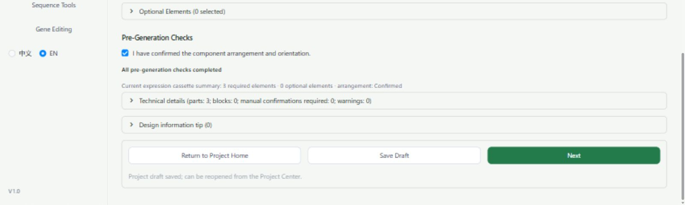
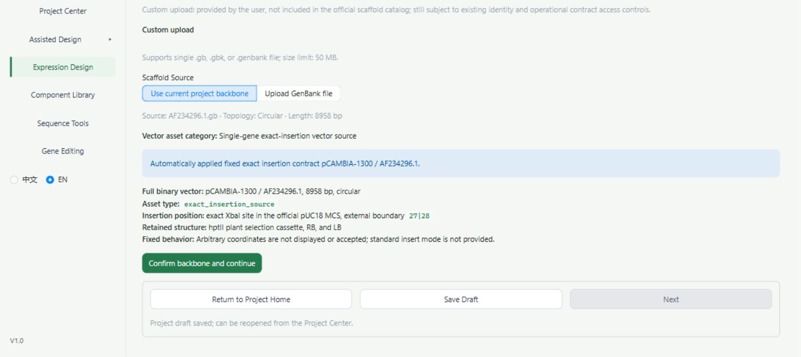
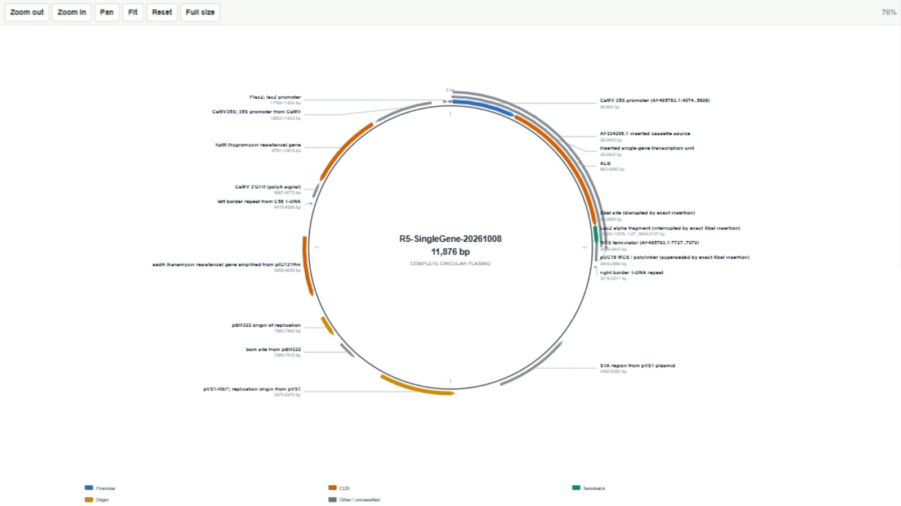
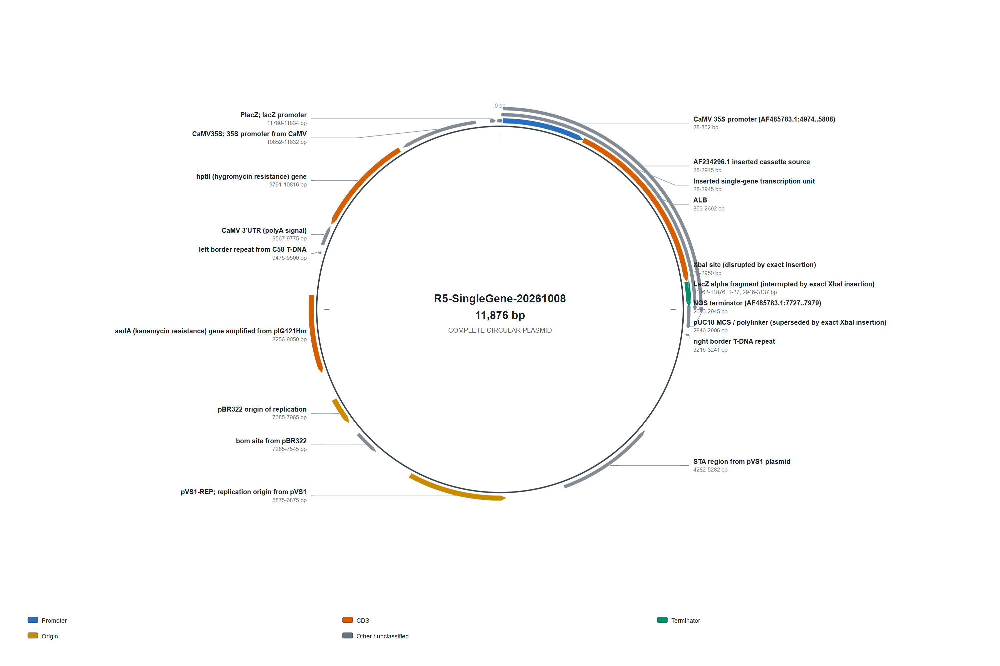
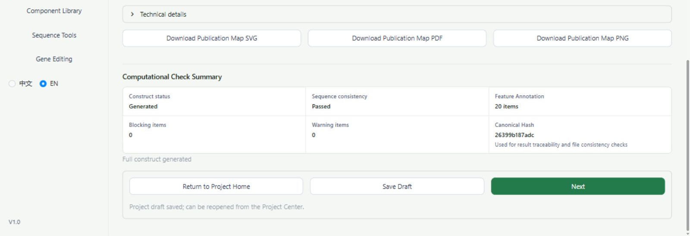
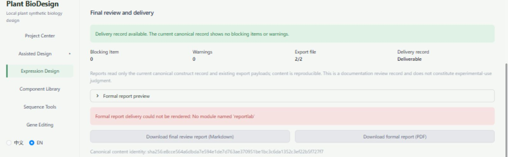
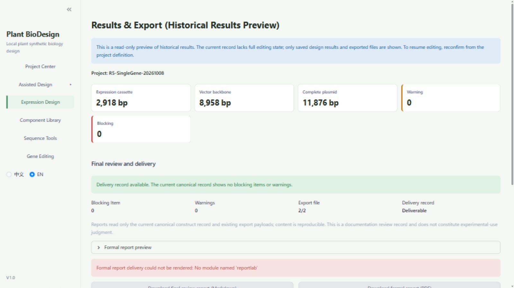

# PlantBioDesign V1.0 User Manual

PlantBioDesign V1.0 · Official public documentation · 2026-10-10

Attribution: PlantBioDesign. This manual introduces the purpose, installation, six-step design workflow, saving, and export for researchers in plant biology, biology, and synthetic biology. Version differences and detailed historical decisions are collected in Chapter 14.

This English R1.2 public edition revises English R1.1 against the independently accepted Chinese `ZH_R4_CORRECTION_CANDIDATE_20261010`. The accompanying reproducibility guide and software overview use the same authoritative content baseline. The Chinese review GO applies to Chinese corrections and the translation basis only; this edition is published documentation and does not constitute software acceptance.

The frozen submission source-code commit underlying the paper analysis is `8ead74c060c32e653e746030e557398637a2c2fc`. The GitHub distribution snapshot used for the ALB operations in this manual is `176232bdd20eb0ae987b52ad8b84df1f71b35a39`; its `SOFTWARE_SNAPSHOT.md` identifies the submission source above as its origin. These commits identify the paper source and the GitHub distribution separately; this statement does not establish file-by-file equivalence between them. The ALB operation records do not extend the validation scope of the paper cases MT-01/MT-02.

In the ALB operation chapters, the retained term "frozen version" refers to the software operation baseline in that distribution snapshot; it does not identify that commit as the paper's frozen submission source.

The screenshots retained from R4 were obtained using an isolated running copy of the frozen commit and a copy of the historical R5 ALB database. Historical generation conclusions remain unchanged; these images establish only what was visible during that review. The operation screenshot record remains incomplete and does not constitute successful public-release acceptance. This translation introduces no new software testing.

## Reading guide

1. Software overview
2. Download, installation, and launch on Windows
3. Home page and Project Center
4. Creating a single-gene project
5. The six-step single-gene design workflow
6. Plant host and target gene input (Steps 1–2)
7. Component Library and promoter/terminator selection (Step 3)
8. Vector backbone selection and restrictions on formal use (Step 4)
9. Complete construct, results, and plasmid map (Steps 5–6)
10. Save and reopen
11. FASTA and GenBank downloads
12. Formal reports and current limitations
13. Troubleshooting
14. Software versions, references, and GitHub

## 1. Software overview

PlantBioDesign (displayed as Plant BioDesign in the interface and called BioDesign Studio in some historical descriptions) organizes plant expression vector designs. It records host and gene provenance, assembles an expression cassette, selects an eligible vector backbone, displays the computationally generated plasmid, and saves and exports design records.

In this case, an expression cassette is a DNA fragment comprising a promoter, coding sequence (CDS), and terminator. A full plasmid also includes the vector backbone. Software results support design documentation and human review; they do not establish successful expression in plants, experimental safety, or readiness for laboratory use. R5 supplied no wet-lab data.

### 1.1 Main functions and scope

The six-step workflow connects the host, target gene, regulatory components, vector backbone, complete construct, and export records. It supports computational design, sequence provenance documentation, and human review of plant expression constructs. The operations covered here are limited to the human ALB single-gene case with rice as the intended host, using user-supplied sequences and the designated backbone upload route. The presence of other entry points does not establish their validation.

This ALB single-gene example is an independent operational demonstration, not a result from the paper cases MT-01 or MT-02. Those cases concern a 4079 bp source region with two transcription units and a 6609 bp source region with three transcription units, respectively; neither establishes independent reconstruction of a complete plasmid.

The paper's base-by-base agreement is limited to the designated source regions and their sequence exports. Sequence checks for this ALB case must be interpreted within the scope stated for each review round; they do not establish independent reconstruction of complete plasmids, validation of all annotations, formal report delivery, or wet-lab validation.

Existing records support expression cassette and full plasmid generation, viewing after save and reopen, and sequence downloads for this case. Formal report downloads, backbone catalog selection, provenance summaries, and restoration for editing remain limited (Chapters 10–12). Improvements in unadopted candidates are not functions of the V1.0 documented here.

## 2. Download, installation, and launch on Windows

### 2.1 Supported evidence and downloads

The frozen submission source-code commit underlying the paper analysis is `8ead74c060c32e653e746030e557398637a2c2fc`. The GitHub distribution snapshot used for the ALB operations in this manual is `176232bdd20eb0ae987b52ad8b84df1f71b35a39`; its `SOFTWARE_SNAPSHOT.md` identifies the submission source above as its origin. These commits identify the paper source and the GitHub distribution separately; this statement does not establish file-by-file equivalence between them. The ALB operation records do not extend the validation scope of the paper cases MT-01/MT-02.

Existing R4 records verified Windows x64, Python 3.12.10, the frozen commit, and installation from the locked dependency list. The documentation task did not repeat the installation audit. There is no evidence in this task that a downloaded EXE can simply be double-clicked to run; the instructions below use Python.

Open the [GitHub repository](https://github.com/1176719502/PlantBioDesign). To avoid obtaining later changes, download the [ZIP of the GitHub distribution snapshot used for the ALB operations](https://github.com/1176719502/PlantBioDesign/archive/176232bdd20eb0ae987b52ad8b84df1f71b35a39.zip), save it, and use Windows **Extract All**. The extracted directory should contain `software`. Browser download and Extract All were not separately tested in the source documentation task. The verified installation used an R4 checkout of the same commit; these two acquisition routes must not be described as one acceptance test.

Prepare Windows x64 CPython 3.12; the version actually verified in the records was CPython 3.12.10. Consult the [official Windows download page](https://www.python.org/downloads/windows/) and confirm that `py -3.12` works. No passing evidence is available here for 32-bit or ARM interpreters. Run the commands in PowerShell. They are copyable instructions derived from the recorded launch procedure; the source task checked syntax and path logic without downloading, installing, or launching the frozen software for this installation audit.

### 2.2 Installing the runtime environment

Open PowerShell in the extracted directory containing `software` and execute the following complete block in order. The environment and project data are stored separately under `C:\PlantBioDesignReview`, outside the software source directory.

```powershell
$ErrorActionPreference = 'Stop'
$manualSoftware = Join-Path (Get-Location).Path 'software'
if (-not (Test-Path -LiteralPath (Join-Path $manualSoftware 'app.py'))) {
    throw '请先在包含 software 文件夹的解压目录中打开 PowerShell。'
}
$manualRoot = 'C:\PlantBioDesignReview'
$manualEnv = Join-Path $manualRoot 'env-v1-frozen'
New-Item -ItemType Directory -Path $manualRoot -Force | Out-Null
py -3.12 --version
if ($LASTEXITCODE -ne 0) { throw '未找到 Python 3.12，请先完成安装。' }
@'
import platform, struct, sys

print(
    platform.python_implementation(), platform.machine(), struct.calcsize("P") * 8
)
sys.exit(
    0
    if platform.python_implementation() == "CPython"
    and platform.machine().lower() in ("amd64", "x86_64")
    and struct.calcsize("P") == 8
    else 1
)
'@ | py -3.12 -
if ($LASTEXITCODE -ne 0) { throw '本锁定环境要求 Windows x64 / 64 位 CPython 3.12；当前解释器架构不匹配。' }
if (Test-Path -LiteralPath $manualEnv) {
    throw '安装目录已存在；已有环境请使用下一节启动，不要覆盖。'
}
py -3.12 -m venv $manualEnv
if ($LASTEXITCODE -ne 0) { throw '运行环境创建失败。' }
$manualPython = Join-Path $manualEnv 'Scripts\python.exe'
& $manualPython -m pip install --only-binary=:all: --require-hashes -r (Join-Path $manualSoftware `
'requirements-runtime.lock')
if ($LASTEXITCODE -ne 0) { throw '安装失败；保留完整错误信息，并按下方“安装失败重试”操作，不要直接重复整块命令。' }
& $manualPython -m pip check
if ($LASTEXITCODE -ne 0) { throw '依赖检查未通过，暂不启动。' }
```

`requirements-runtime.lock` records package versions and file hashes. Do not substitute the historical `requirements.txt`. Successful installation does not establish that all functions work: the frozen list omits ReportLab, required for reports, and both R5 formal report downloads were blocked as a result (Chapter 12). No temporary dependency-installation workaround for the frozen environment is provided here.

**Retrying a failed installation.** If dependency installation fails after creating the venv, an existing directory does not mean the environment can run. Do not rerun the entire block, which rejects an existing environment directory. With the same source version and root configuration, use the existing isolated interpreter:

```powershell
$ErrorActionPreference = 'Stop'
$manualSoftware = Join-Path (Get-Location).Path 'software'
$manualRoot = 'C:\PlantBioDesignReview' # 若上方改过根目录，这里保持相同
$manualPython = Join-Path $manualRoot 'env-v1-frozen\Scripts\python.exe'
if (-not (Test-Path -LiteralPath $manualPython)) { throw '解释器尚未创建成功，请保留创建环境的错误信息。' }
if (-not (Test-Path -LiteralPath (Join-Path $manualSoftware 'requirements-runtime.lock'))) { throw `
'请返回包含 software 的固定源码解压目录。' }
& $manualPython -m pip install --only-binary=:all: --require-hashes -r (Join-Path $manualSoftware `
'requirements-runtime.lock')
if ($LASTEXITCODE -ne 0) { throw '锁定依赖重试失败；保存完整日志并停止。' }
& $manualPython -m pip check
if ($LASTEXITCODE -ne 0) { throw '依赖检查失败；暂不启动。' }
```

Proceed only if both installation and `pip check` succeed. Syntax and control flow were checked, but installation failures were not replayed on a machine during the source round. Do not delete runtime data, disable hash verification, or install undeclared packages.

**Directory permissions.** If creating `C:\PlantBioDesignReview` is denied, choose a writable directory, for example by setting `$manualRoot` in every block to `Join-Path ([Environment]::GetFolderPath('MyDocuments')) 'PlantBioDesignReview'`. Installation, retry, and launch must use the same root. Continue using the original runtime for existing projects. Access depends on local ACLs and organizational policies; denial was not established as a universal failure, and running as administrator is not the default requirement. Execute environment-variable commands in a dedicated PowerShell window.

### 2.3 Launching and subsequent restarts

Each time, open PowerShell in the extracted directory containing `software` and execute the complete block below. Keep the window open. Once the local address appears, open [http://127.0.0.1:8634](http://127.0.0.1:8634) in a browser. `127.0.0.1` refers to the local computer; 8634 is the port used by this manual.

```powershell
$ErrorActionPreference = 'Stop'
$manualSoftware = Join-Path (Get-Location).Path 'software'
$manualRoot = 'C:\PlantBioDesignReview' # 与安装/重试相同
$manualPython = Join-Path $manualRoot 'env-v1-frozen\Scripts\python.exe'
$manualRuntime = Join-Path $manualRoot 'runtime-v1-frozen'
if (-not (Test-Path -LiteralPath $manualPython)) { throw '请先完成安装。' }
if (-not (Test-Path -LiteralPath (Join-Path $manualSoftware 'app.py'))) {
    throw '当前文件夹不正确，请返回包含 software 的解压目录。'
}
$manualPort = 8634
if (Get-NetTCPConnection -LocalPort $manualPort -State Listen -ErrorAction SilentlyContinue) {
    throw "$manualPort 已被占用；请先确认是否为自己的软件窗口，不要停止未知进程。"
}
New-Item -ItemType Directory -Path $manualRuntime -Force | Out-Null
$env:BIODESIGN_DB_PATH = Join-Path $manualRuntime 'biodesign_unified.db'
$env:BIODESIGN_PLANT_PROJECT_DRAFT_DIR = Join-Path $manualRuntime 'project_drafts'
$env:BIODESIGN_BACKUP_DIR = Join-Path $manualRuntime 'backups'
$env:BIODESIGN_PYDNA_CONFIG_DIR = Join-Path $manualRuntime 'pydna\config'
$env:BIODESIGN_PYDNA_DATA_DIR = Join-Path $manualRuntime 'pydna\data'
$env:BIODESIGN_PYDNA_LOG_DIR = Join-Path $manualRuntime 'pydna\logs'
$env:LOCALAPPDATA = Join-Path $manualRuntime 'local-app-data'
$env:PYTHONDONTWRITEBYTECODE = '1'
Push-Location -LiteralPath $manualSoftware
try {
    & $manualPython -m streamlit run app.py --server.address 127.0.0.1 --server.port $manualPort `
--server.headless true --server.fileWatcherType none
} finally {
    Pop-Location
}
```

Save the project before pressing `Ctrl+C` in this PowerShell window to stop the instance you started. Relaunch with the same software version and `runtime-v1-frozen` directory to retrieve projects saved there. If changing the port, update `$manualPort`, the port-occupancy check, `--server.port`, and the browser URL together; do not automatically terminate unknown processes. These paths and this address are the manual's user-facing setup, not the original R5 audit database.

Historical documentation also mentions 8528 (development) and 8632 (review package); R4 used 8633, R5 used 8634, and the R5.2A candidate used 8636. Different ports do not indicate a software upgrade. Do not mix project data across instances or treat a development instance as the frozen version.

The executable code blocks in this English edition are copied unchanged from R4, including Chinese diagnostic strings and comments. Use the Markdown blocks as the execution source; their surrounding English text explains their purpose.

## 3. Home page and Project Center

1. Click `Project Center` in the left sidebar.
2. Click `New Single Gene project` or `New Multi-TU project`.
3. Use `Recent projects`, `All projects`, `Archived`, and `Search project name` in the project browser.
4. Click `Open` for a saved project; click `More` for other operations.

`New Multi-TU project` and `More` are described only as existing visible entry points, not as accepted operations in this manual. Existing records confirm that the single-gene entry opens Step 1 and that this case was completed, saved, reopened for viewing, and exported as sequence files.


The main sidebar entries have the following scope in this manual.

| Interface text | Meaning and coverage |
| --- | --- |
| Project Center | Create and reopen projects; tested in R5 |
| Expression Design | Six-step single-gene workflow; tested in R5 |
| Component Library | Eligibility messages in Step 3 were observed; the full standalone browsing/filtering workflow remains unverified |
| Assisted Design | Entry visible; operation acceptance not completed here |
| Sequence Tools | Entry visible; not verified here |
| Gene Editing | Entry visible; not verified here |

`中文` and `EN` are visible at the lower left. R5 screenshots used EN; the Chinese manual explained them in Chinese while retaining actual English controls. English mode still contains Chinese labels and some untranslated text. A complete step-by-step regression of the Chinese interface is unavailable, so every Chinese button is not guaranteed to match the manual's translation.

## 4. Creating a single-gene project

1. In Project Center, click `New Single Gene project` to enter `Expression Design`.
2. In Step 1, choose `Standard plant expression vector` and `Single Gene`.
3. Enter a project name and host. The R5 example is `R5-SingleGene-20261008`, with `Rice / Oryza sativa` as the host. Use your own name for a new project.
4. Complete the required expression objectives on the page. Optional cultivar or experimental-material fields may remain blank when information is unavailable; do not invent results.

If a refresh leaves you on the design page, the same session may have been retained. Use `Return to Project Home` to return to Project Center, then decide whether to create or open a project. Refreshing does not itself create an empty project. This explanation follows the R4 entry diagnosis and R5 six-step records.


## 5. The six-step single-gene design workflow

Complete the steps in order. `Next` becomes available only when the current conditions are met. Changed inputs may require new analysis or generation; do not reuse an outdated result.

| Step | Task | Actual R5 result and relevant chapters |
| --- | --- | --- |
| 1. Project Definition | Define the project, host, and expression objectives | Completed for this case; Chapters 4 and 6 |
| 2. Target Gene | Enter the CDS, document provenance, analyze, and confirm | Completed for this case; Chapter 6 |
| 3. Plant Expression Cassette | Select or enter the promoter and 3′ element, confirm arrangement, and generate | User sequence route completed; 2918 bp; Chapter 7 |
| 4. Vector Backbone | Check the backbone and permitted insertion scheme | Catalog selection failed; authentic GenBank upload succeeded; Chapter 8 |
| 5. Complete Construct | Generate the full plasmid and inspect checks and map | 11876 bp circular plasmid generated; Chapter 9 |
| 6. Results and Export | Save, review, and download sequences and reports | Saving and sequence downloads succeeded; frozen reports blocked; Chapters 10–12 |

`Completed` is a step status and `Saved` is a saving status. Neither `0 warnings` nor `Deliverable` replaces inspection of actual files. R5 reached Step 6 but did not pass overall acceptance.

## 6. Plant host and target gene input (Steps 1–2)

### 6.1 Host and expression objectives

The host is the plant intended to express the foreign gene and need not be the gene's source species. R5 used rice as the host and human (Homo sapiens) ALB as the target. This difference is not an input error and does not establish expression performance in rice.

R5 Step 1 specified `Stable genetic transformation`, no particular tissue or organ restriction, no specific induction requirement, and undetermined subcellular localization. Enter your actual design objectives; do not automatically apply these example settings to other studies. Other hosts, objective combinations, and complete routes fall outside the verified scope here.

### 6.2 Entering and checking the CDS

1. Enter `Target Gene`. Set the gene name to `ALB` and the source type to `Public database record`.
2. In `Accession or source note (required)`, record the version, source species, and coordinates. R5 used `NM_000477.7`, human ALB, positive strand `42..1871`.
3. Expand `Source and advanced information` and check the gene symbol, source species, and modification status. This case uses `Unmodified source sequence`; leave `This input is a partial CDS` unchecked.
4. Paste the actual CDS as a nucleotide sequence or named FASTA record. A FASTA header begins with `>`; nucleotide sequence follows below. The header is not part of the nucleotide sequence. Do not substitute a full transcript, protein sequence, or empty name-only record for this CDS.
5. The page automatically creates an analysis preview. Check length, a single record, A/C/G/T characters, reading frame, start/terminal codons, and internal stop codons. Expand `CDS completeness checklist` for details. Resolve blockers as instructed; do not arbitrarily edit the sequence to suppress them.
6. Click `Confirm CDS and continue` to retain the current analysis and enter Step 3. If changed input requires review, check the current preview before confirming again. The complete CDS, source note, and 1830 bp length should agree. These controls and analysis-preview descriptions were checked read-only against frozen source and English language files; the original screenshots do not fully cover them. R5 operation records, subsequent step states, and exports establish completion for this case.


> Evidence limitation: the historical portrait source-input image (889×1244 px) was removed from the main text. This authentic landscape view establishes only that the gene name and source fields are empty after reopening the same ALB project. Can continue reflects an existing saved record, not full input restoration or successful operations in that screenshot round. No fields were refilled, confirmed, or regenerated.

The original R5 inputs were saved, but reproduction must not depend on local paths. Follow the [Case Input Reproducibility Guide](CASE_INPUT_REPRODUCIBILITY.md) to obtain three versioned GenBank records from NCBI and extract sequences by coordinates and strand. The guide provides file and nucleotide SHA-256 procedures, normalization rules, and final-result checks. It uses standard tools and short inspectable commands, without project-specific helper scripts. This public edition does not distribute raw GenBank records, FASTA, sequence JSON, or complete derived constructs.

| Material | Historical local R5 input filename (not included) | Recorded length |
| --- | --- | ---: |
| ALB CDS | `ALB_NM_000477.7_cds.fasta` | 1830 bp |
| CaMV 35S | `CaMV35S_AF485783_4974_5808.fasta` | 835 bp |
| NOS terminator | `NOS_AF485783_7727_7979.fasta` | 253 bp |
| pCAMBIA-1300 vector backbone | `AF234296.1.gb` | 8958 bp |

Members of the public can independently obtain the input records lawfully, but retrieval is not software provenance review or biological approval. Recording an accession does not automatically establish sequence identity. R5 still entered the promoter and terminator as user sequences, and the provenance summary remains unresolved. This tutorial establishes reproducible retrieval and nucleotide identity without upgrading the inputs to formal library eligibility or complete provenance certification.

## 7. Component Library and promoter/terminator selection (Step 3)

Click `Component Library` and inspect the displayed source, component, orientation, version, and human-confirmation status. The complete standalone library interaction remains unverified. The verified scope here is the actual selection messages and user sequence route in Step 3 of the six-step workflow.

1. Review the source choices for the promoter and `3′ Regulatory Element`. If choosing `Component Library`, read the formal eligibility message first. Do not substitute demonstration entries when no eligible components are available.
2. Under the rice settings selected in R5, the page reported no corresponding components eligible for formal selection. Switch to `User sequence` and enter each name and authentic DNA/FASTA. Use `CaMV 35S promoter (AF485783.1:4974..5808)` and `NOS terminator (AF485783.1:7727..7979)`.
3. Choose `Transcription terminator` as the biological role of the 3′ element in this case. The CDS comes from Step 2. Changes to the CDS during project creation require reanalysis as instructed. For reopened projects, read the 1→2→3 navigation limitation in Section 10.1 first; returning does not guarantee restored editing.
4. Add no optional components for this example. Verify promoter → ALB CDS → NOS terminator and the orientation, then select `I have confirmed the component arrangement and orientation`.
5. Resolve blockers and click `Generate expression cassette`. Check the generated result (2918 bp in R5), then click `Next`.


> Figures 4a and 4b are authentic partial views with an undisplayed region between them; they are not continuous complete coverage. Generated comes from the saved record. No expression cassette was regenerated in that screenshot round.



> Landscape partial evidence: orientation confirmation, check summary, and Next are retained; the complete sequence-input area is not shown. Figures 4a and 4b do not establish a complete input or generation operation chain.

The Step 3 screenshot record remains incomplete. No new sequence-input area was made public, and the deliberate framing gap between Figures 4a and 4b remains. Generated reflects the saved record, not regeneration in that round.

R5 length check: 835 bp promoter + 1830 bp CDS + 253 bp terminator = 2918 bp. This sum applies only to this construct without additional components.

**Acceptance of a user sequence does not confer formal Component Library eligibility.** Confirming arrangement and orientation is not provenance review. Detailed promoter and terminator provenance still appears in Chinese as “user-provided, awaiting confirmation,” while the top-level summary says “not provided.” Preserve original provenance documentation separately.

## 8. Vector backbone selection and restrictions on formal use (Step 4)

### 8.1 Checking the catalog first

After completing the expression cassette, enter `Vector Backbone`. R5 displayed `pCAMBIA-1300 / AF234296.1` as `Officially available`, but clicking `Select` produced:

> Catalog asset pcambia1300_af234296_1 source record cannot be read.

The frozen distribution lacks the local source record referenced by the catalog; the ALB case was not rejected by formal eligibility rules. R5.1 identified the cause. Neither the frozen version nor the R5.2A report candidate fixed this catalog problem. `Officially available` does not guarantee that the file can be read.

### 8.2 Upload route verified for this case

1. Select `Upload GenBank file` only when you hold an authentic full backbone record whose use is permitted for your purpose.
2. Use `Browse files` to choose authentic `AF234296.1.gb`. The page accepts single-record `.gb`, `.gbk`, and `.genbank` files and displays a 50 MB limit. R5 verified only this `.gb`, not every format or size boundary.
3. Check that the page identifies AF234296.1, 8958 bp, and `Circular`, with the fixed insertion rule applied automatically.
4. Check external boundary `27|28`: insertion between bases 27 and 28 of the original backbone. The internal index is 27; users need not convert or enter arbitrary coordinates. This route offers neither standard reverse insertion nor arbitrary coordinates.
5. After checking identity and the fixed rule, click `Confirm backbone and continue` to enter Step 5. This button name was checked read-only against frozen source and English language files. Figure 5 fully covers the restored contract and button, but does not establish a new upload in that screenshot round. R5 upload success does not establish successful catalog `Select`.



> The image shows an existing reopened backbone record. No new upload or confirmation was performed; both the confirmation button and disabled Next state are retained.

That round only viewed the saved backbone; it did not upload GenBank again or click confirmation. Successful authentic upload belongs to the historical R5 operation evidence.

The formal route for R5 is `single_gene_rice_alb`. Do not generalize this backbone to other hosts, genes, or Multi-TU projects. pBI121 is restricted to other fixed workflows on this page. pBIN19 and the local r229 example have no available formal operation rule here and cannot substitute for this case's backbone. Arbitrary GenBank upload does not automatically confer formal construct eligibility. Retain unselectable states and blockers; do not bypass them by renaming files or editing software rules.

## 9. Complete construct, results, and plasmid map (Steps 5–6)

1. In Step 5, check the expression cassette, vector backbone, insertion site, orientation, and T-DNA boundary status.
2. Click `Generate full vector`. This name was checked read-only against frozen source and English language files; the R5 screenshots show the post-generation view. If generation conditions are unmet, resolve the messages first. Do not treat pending-review or outdated results as the current construct.
3. R5 generated an 11876 bp circular plasmid with forward insertion and computational checks showing 0 blockers and 0 warnings. The length is 8958 + 2918 bp; an independent comparison confirmed insertion at the fixed boundary.
4. Inspect the plasmid map in `Full Construct Preview`, which displays the project name, total length, backbone, and inserted-fragment annotations. The images below show reopening of the historical R5 result, not new generation in that round.
5. Click `Next` for Step 6. Check component order and the result summary in `Structural overview`. The page also displays `Circular view`, `Linear view`, `Sequence`, and `Check results`. Their presence is confirmed, but R5 did not fully accept each tab interaction, so every graphic and operation is not guaranteed to have passed.




> The software's internal map scale is 76%. No interface content was redrawn. Use the native export in Figure 6c for smaller labels.



> This is a native software export, not an interface screenshot. The 3000×2000 pixels, labels, leader lines, and crossings are retained without cropping or redrawing.



> Landscape partial evidence: the checks, download controls, and Next within this view are fully retained. Actual PNG map download has evidence from the preceding round; SVG/PDF downloads remain NOT_PROVEN.

The source screenshot round used Full size, Fit, and one Zoom in operation and verified that the PNG map download was saved. Figures 6b and 6c have no boundary clipping; the native PNG supports reading all labels. SVG/PDF map downloads, Pan, and Reset were not fully accepted and remain NOT_PROVEN. Existing crossings between leader lines and nearby ring labels are retained. Complete visibility does not establish biological correctness of annotations. See Chapter 11 for sequence downloads.

Computational checks do not replace review of biological function, annotation quality, or experimental suitability. In particular, `0 warning` does not resolve the provenance gaps in Chapter 7.

## 10. Save and reopen

Existing operation records verify saving, reopening after a program restart, and retention of core sequences for this ALB case. Provenance-summary completeness has not passed.

1. `Save Draft` is visible during design and can be used for interim records. R5 retains a draft-saving message, but restoration of every step's draft under all interruptions was not independently verified.
2. In Step 6, click `Save Project`. Wait for `Project saved; can be reopened from the Project Center.` before leaving.
3. Download `Project Backup (JSON)` into your project folder. It is an additional record backup, not FASTA, GenBank, or a formal report. JSON import and disaster recovery are not verified here.
4. Find the same project in Project Center and click `Open`. Search by name or use `Recent projects`, `All projects`, and `Archived`. Archiving and restoration were not fully accepted.
5. After reopening, check the project name, host, gene name, components, backbone, and three lengths. **A saved project may reopen at Step 1; this is not by itself a saving failure, and Step 6 is not a guaranteed landing point.** One original R5 screenshot after a restart and new session showed Steps 1–5 as `Completed`, Step 6 as `Current step`, and a `Saved` banner. It does not guarantee the landing point for every project. Step 2 fields may also be empty; read Section 10.1 first.


> The saved message comes from the historical project record and does not establish a new successful save in that round. The report error remains visible.


> Six-step and Saved states come from historical saved records and do not establish complete restoration of six-step inputs.

That round opened an isolated copy of the historically saved project without saving it again. The states in Figures 7 and 8 are not evidence of a new successful save.

### 10.1 Editing restoration and provenance-summary limitations

In the verified case, the Step 2 gene name, source note, and pasted-CDS fields did not display their saved values after reopening, although 1830 bp and `Matches saved CDS` remained visible. The gene name, detailed provenance, original FASTA, and nucleotides remained in the project draft JSON. This is not the SQLite project-history-table saving route. Empty fields alone establish neither sequence loss nor unchanged values for every backup field.

Confirming or interacting with fields may submit empty values and flag an unchanged design for review. Editing Step 1 experimental material also triggered a historical read-only preview. Revisiting Steps 1→2→3 could fall back to `Results & Export (Historical Results Preview)`, preventing normal continued editing. Direct visits to Steps 3–5 displayed saved results before the trigger, but are not a recovery method after it.

**Frozen V1.0 has no verified method for complete editing restoration.** Refreshing, reopening, JSON import, reconfirming Step 1, or editing the database are not verified remedies. Visibility of `Return to Project Home` does not establish restoration of editing state. The failure was observed in both frozen and candidate comparisons; it cannot be attributed to a new report-candidate defect or generalized to every project.

If editing fails, retain obtainable JSON, FASTA, GenBank, error text, screenshots, and logs, and stop overwriting original data. Provide the maintainer with version, port, and runtime directory; check sequence-sharing rights first. Root-cause and unadopted-candidate information appears in Chapter 14.

The detailed ALB source `NM_000477.7` remains saved, but the summary reference shows `not_provided`. Promoter and terminator summaries also say not provided. Preserve accession, version, coordinates, original files, and source notes separately.

JSON size and hash differed before and after saving, partly because restoration fields were added; this alone does not establish nucleotide corruption. Historical records show that three sequence exports were unchanged after reopening, not that every JSON field was identical.

## 11. FASTA and GenBank downloads

In Step 6 `Save and Export`, click the actual buttons below separately. Confirm browser download completion and open the real files; a clickable button is insufficient.

| Button | Purpose | Verified R5 result |
| --- | --- | --- |
| Expression cassette FASTA | Expression cassette sequence only | 2918 bp; unchanged after reopening |
| Full plasmid FASTA | Full plasmid nucleotide sequence | 11876 bp; unchanged after reopening |
| Full plasmid GenBank | Full plasmid sequence and annotations | 11876 bp, 20 features; unchanged after reopening |
| Project Backup (JSON) | Project record backup | Downloadable; core records retained, provenance summary incomplete |

See Figure 7 for positions. Files usually go to the browser's Downloads location or a destination selected in browser settings. R5 full plasmid filenames begin with `complete_plasmid_26399b187adc487a`, ending in `.fasta` or `.gb`; expression cassette filenames begin with `construct-...`; the JSON is `project_backup.json`. Names vary with project and content, and repeated downloads may add `(1)`. Do not hard-code one filename for all projects.

Actual R5 parsing confirmed character-for-character agreement of the full plasmid FASTA and GenBank nucleotide sequences, retained after save and reopen. GenBank annotations also agreed before and after reopening. Their biological correctness was not independently certified.

The case's nucleotide SHA-256 values (sequence fingerprints) are:

| Object | Existing verified value |
| --- | --- |
| Expression cassette nucleotide sequence | `8422558a6f117fb27debb3fc96ad3b954e22de904c0e48fe7eece447413bac7f` |
| Full plasmid nucleotide sequence | `26399b187adc487ac7cdc2f56bf260a35175f8970f29de6349cd99ceecc1667c` |

These fingerprints cover only nucleotides, excluding FASTA headers, line breaks, and GenBank annotations. A Windows file checksum covers the whole file and cannot be compared directly. Historical file-byte checksums remain in the original export-consistency report and are not attached here. Record file-byte SHA-256 separately for downloaded responses and actual exports.

## 12. Formal reports and current limitations

### 12.1 Frozen V1.0: both reports blocked

Step 6 displays `Formal report preview`, `Download final review report (Markdown)`, and `Download formal report (PDF)`. In the original locked R5 environment, both download buttons were disabled with:

> Formal report delivery could not be rendered: No module named 'reportlab'



> Landscape failure evidence: the error text and disabled download buttons are fully retained. This does not establish successful report generation or download.

R5.1 confirmed that the runtime installation list omits ReportLab. The frozen interface handles Markdown and PDF in the same error block, so PDF-module import failure disables both downloads. An isolated diagnostic generated a four-page PDF, but that file is not an actual frozen-interface download. Three-way consistency of frozen software reports and sequences remains unproven.

### 12.2 Implications for users

Save obtainable sequences and project backups and document provenance separately. Do not interpret `Deliverable` or `0 warnings` as successful delivery of every item. The PDFs in this documentation package are independently typeset user documents, not evidence that the software generated a formal report successfully.

An existing report-fix candidate completed limited download and fault-isolation checks but has not been adopted. Frozen V1.0 retains its report blockage, provenance gaps, and editing-restoration limitations. See Appendix A in Chapter 14 for versions and historical decisions. This manual provides no instructions to replace frozen code or temporarily add dependencies.

## 13. Troubleshooting

| Symptom | Explanation and action | Existing evidence scope |
| --- | --- | --- |
| Python 3.12 not found | Use the installation version check; install the correct version before creating the environment | R4 tested 3.12.10; other versions not covered |
| Installation/network failure | Retain the full error. If venv exists, retry the same hash-locked install with its interpreter and run `pip check` as in Section 2.2. Do not repeat the whole block that rejects existing directories. Stop and retain evidence if retry fails | Directory gate and launch control flow statically checked; not every network failure tested |
| Browser cannot open the local address | Check that the launch window is running without errors and that address and port agree; retain launch errors for the maintainer | R5 launch method; not all device configurations verified |
| Port occupied | Determine whether it is your own instance; do not stop unknown processes. If a free port is chosen, update `$manualPort`, occupancy check, `--server.port`, and URL together | R4 used 8633 because 8632 was occupied; not an upgrade |
| Refresh does not return home | Session may be retained; use Return to Project Home, then create or open a project | Repeated R4 operations |
| Next disabled / Needs correction | Read required fields, confirmations, and blockers; reanalyze or regenerate after changes | R5 Steps 2–3 and later completion states |
| Component Library shows 0 candidates | No eligible entries under current conditions. Use user sequences only with authentic material and retain provenance responsibility | Selected rice conditions in R5; not all hosts |
| Backbone says officially available, but Select cannot read it | Referenced catalog file is missing; record the error. If use is permitted, upload authentic AF234296.1 as in Chapter 8 | Catalog failure and this case's upload success; not a general fix |
| Cannot continue after backbone upload | Format, identity, or workflow may not satisfy rules; inspect the original record and messages, without renaming to bypass them | Only designated ALB backbone success; no specific failure cause without logs |
| Reopened provenance says not provided | Details may remain while summary is incomplete; retain original files, source notes, and JSON for review | R5/R5.1 mapping inconsistency; not loss of all provenance |
| Both formal report buttons greyed out | Missing ReportLab and shared error handling block frozen R5. Save sequences/backups, record error, and await a reviewed revision | No temporary installation workaround for frozen environment |
| Duplicate download has (1) | Browser numbering of duplicate names; inspect content rather than infer sequence differences from names | Repeated R5 sequence downloads agreed |
| JSON size changed | Restoration fields may change without sequence changes; compare key records and actual nucleotides | R5 core data retained; all-field identity unproven |
| Saved project not visible | Check version, launch data directory, and search scope; do not create a database over the original directory | R5 reopening succeeded after restart with same database/draft directory |
| Saved project reopens at Step 1 | Possible; check identity and saved results. Figure 8 is not a universal Step 6 landing guarantee | Possibility retained; not claimed for every project |
| Step 2 gene/source/CDS fields empty, summary still 1830 bp | Tested project JSON retained the values, but interface restoration failed. Do not overwrite them in an attempted repair; retain evidence | R5.2A-R2 and R5.2B-0 tested cases; not all data lost |
| Confirmation/editing marks changes and enters historical read-only mode | Empty-value submission may falsely mark dirty. Real edits should require review but may also encounter read-only fallback. Stop overwriting original records; see Section 10.1 | Root cause proven in tested R5.2B-0 cases only; no verified frozen V1.0 editing-restoration method |
| Revisiting 1 → 2 → 3 opens historical read-only preview | `Results & Export (Historical Results Preview)` may still permit viewing/download but not normal continued editing. Retain obtainable JSON, FASTA, GenBank, screenshots, and logs; stop overwriting | Observed in R5.2A and frozen comparison; no verified frozen remedy |
| Some plasmid-map labels hard to see | Source round used Full size, Fit, and one Zoom in; boundary labels are complete. Read small labels in native PNG | Figures 6b/6c; PNG verified, SVG/PDF NOT_PROVEN |

For feedback, retain original error text, screenshots, project name, frozen commit, port, and launch-window logs. If unpublished research sequences are involved, decide what may be shared before submitting a complete backup.

The original restriction that public-case contracts prohibit complete derived sequences in the repository retains its scope: frozen MT-01/MT-02 contracts restrict complete derived-sequence distribution. Successful operations in other cases do not cancel this restriction. This manual neither repeats their provenance audit nor distributes those sequences. Source reconstruction, software export, and biological validation are separate evidence categories.

This public edition contains no complete sequences, internal logs, or historical helper scripts. See [License and distribution scope](LICENSE_MANUAL.md) for third-party material and sequence rights.


> The same authentic view as Figure 3 is reused to explain the restoration limitation. No fields were refilled or success state fabricated.



> Historical read-only fallback is limitation evidence, not a successful normal Step 4 operation.

## 14. Software versions, references, and GitHub

| Item | Information retained from the source |
| --- | --- |
| Chinese manual lineage | Existing GitHub Chinese manual and R3 candidate; the original R4 unified documentation candidate was dated 2026-10-09. Chinese R4 corrections were accepted on 2026-10-10 as the content basis for this English R1.2 public edition, published on 2026-10-10 |
| Paper frozen submission source | `8ead74c060c32e653e746030e557398637a2c2fc`; identity of the materials underlying the paper analysis |
| GitHub distribution / ALB operation snapshot | `176232bdd20eb0ae987b52ad8b84df1f71b35a39`; basis for R4/R5 operation records; see `SOFTWARE_SNAPSHOT.md` in that snapshot for its origin |
| Report-fix candidate | `ee85a63a41df890a2981d2da6a83fcb45841633c`; unadopted R5.2A |
| Original R5.2A independent review (2026-10-08) | Historical `R5_2A_INDEPENDENT_REVIEW_NOT_PROVEN` retained; unresolved items remain as stated in that report |
| Subsequent R5.2A-R2 (same day, by review round) | Report delivery limited GO; evidence integrity GO within checked scope; historical zero-new-files claim NO_GO; full six-step editing restoration NO_GO; source citations unresolved; other new-code regressions NOT_PROVEN; overall R5 still not passed |
| R5.2B-0 diagnosis (same day) | `R5_2B_0_ROOT_CAUSE_PROVEN`; tested cases only, not a completed fix |
| R5.2B-1 independent fix candidate | `2dbd3c3f6730f082f5a1a9b0f4c1e97e645144ed`; READY_FOR_REVIEW, unadopted; frozen conclusions unchanged |
| GitHub | [1176719502/PlantBioDesign](https://github.com/1176719502/PlantBioDesign) |
| GitHub distribution snapshot link | [ALB operation distribution snapshot](https://github.com/1176719502/PlantBioDesign/tree/176232bdd20eb0ae987b52ad8b84df1f71b35a39) |

The lower-left `V1.0` label alone cannot distinguish the frozen version from local candidates; check the commit and version notes.

Sources for this case are [NCBI NM_000477.7](https://www.ncbi.nlm.nih.gov/nuccore/NM_000477.7), [AF485783.1](https://www.ncbi.nlm.nih.gov/nuccore/AF485783.1), and [AF234296.1](https://www.ncbi.nlm.nih.gov/nuccore/AF234296.1). Accessions identify records, not authorization. Distinguish NCBI policy from third-party intellectual property; see [Molecular Data Usage](https://www.ncbi.nlm.nih.gov/home/about/policies/#molecular-data). Historical R2 downloaded, extracted, and independently checked four inputs, the 2918 bp expression cassette, and the 11876 bp plasmid. That passing conclusion is retained. The original reproducibility guide records a new NCBI download on 2026-10-09 and checks of four input sequences, the 2918 bp expression cassette, and the 11876 bp sequence-level reconstruction. The original integration round did not repeat software export or reopening tests. The screenshot-remediation round did reopen the saved historical project and download expression cassette FASTA, full plasmid FASTA/GenBank, and project JSON; nucleotide lengths and hashes agreed. Complete six-step editing restoration, full GenBank qualifier consistency, and JSON import remain failed or NOT_PROVEN. Retrieval and extraction are described in the [reproducibility guide](CASE_INPUT_REPRODUCIBILITY.md), consistently with the passing R2 record. This validates nucleotide identity, not comprehensive distribution rights, provenance eligibility, or biological function.

The following background references are retained from the previously verified PAPER-01 R1.1 bibliography. They do not imply that this case implements all the tools or cloning methods described:

1. Lescot M. et al. PlantCARE, a database of plant cis-acting regulatory elements and a portal to tools for in silico analysis of promoter sequences. *Nucleic Acids Research*, 2002, 30(1): 325–327. [DOI: 10.1093/nar/30.1.325](https://doi.org/10.1093/nar/30.1.325).
2. Engler C., Kandzia R., Marillonnet S. A One Pot, One Step, Precision Cloning Method with High Throughput Capability. *PLoS ONE*, 2008, 3(11): e3647. [DOI: 10.1371/journal.pone.0003647](https://doi.org/10.1371/journal.pone.0003647).
3. Weber E. et al. A Modular Cloning System for Standardized Assembly of Multigene Constructs. *PLoS ONE*, 2011, 6(2): e16765. [DOI: 10.1371/journal.pone.0016765](https://doi.org/10.1371/journal.pone.0016765).

The maintainer has not yet supplied the software paper's formal citation, author order, or DOI. None is invented here. References were retained from R4, not newly verified against external databases in this translation round.

### Appendix A. Historical decisions and unadopted candidates

This information supports version traceability, not installation of candidates or bypassing restrictions. Historical operations and sequence checks remain limited to their cases and environments. Limited reopened views, downloads, and map-framing evidence from screenshot remediation are identified separately and do not upgrade overall historical software acceptance.

### Appendix A.1 R5.2A: actual report-download evidence, not adopted for release

The isolated R5.2A candidate added report dependencies and separated Markdown/PDF error handling. The original final independent review on 2026-10-08, `R5_2A_INDEPENDENT_REVIEW_NOT_PROVEN`, is retained as a historical decision. Report downloads had passing evidence, but evidence protection, six-step editing restoration, and provenance completeness were unresolved. Creation of SQLite `db-wal/db-shm` in the historical R5 directory was an evidence-protection deviation in that review, not a new software defect introduced by the candidate.

Subsequent R5.2A-R2 decisions on the same date are separated by object below. Subsequent refers to review-round order; no specific times are invented.

| Object | Final R5.2A-R2 decision | Scope |
| --- | --- | --- |
| Report-delivery fix | **Limited GO** | Report rendering, Markdown/PDF downloads, PDF fault isolation, and tested sequence-content consistency |
| Evidence integrity and original database-content trustworthiness | **GO within checked scope** | Original main database and evidence-content hashes stable; origins of added auxiliary files disclosed; excludes unscanned metadata and guarantees against concurrent writes |
| Historical R5 directory claim of zero new files throughout | **NO_GO** | Empty WAL and SHM were actually created in the original round; unchanged main database does not negate directory additions |
| Complete six-step editing restoration | **NO_GO** | Empty Step 2 fields and read-only fallback after sequential navigation and Step 1 edits tested; saved results and editing restoration judged separately |
| Source-citation completeness | **Unresolved**; provenance-complete report acceptance NO_GO | Detailed provenance contradicts summary; component report references missing; does not invalidate limited delivery-fix GO above |
| Other new-code regressions | **NOT_PROVEN** | No new report regression observed on tested paths; limited cases cannot establish no regressions on all paths |
| Overall R5 | **Still not passed**; unconditional acceptance NO_GO | Limited GO cannot replace complete restoration, provenance completeness, or formal adoption |

The underlying evidence scopes are described by the historical integrity clarification, six-step restoration, and provenance-boundary records. These updates complete the decision chain without deleting the original NOT_PROVEN or the WAL/SHM additions.

In the original round, the same saved R5 project's Markdown and PDF were each byte-identical before and after reopening; the PDF opened and rendered to four pages. For the subsequent R5.2A-R2 new project, all three sequence exports remained byte-identical, but JSON and Markdown differed because ReportSnapshot, manifest, and delivery identifiers were regenerated. Construct and sequence identities remained unchanged. Do not generalize this to byte-identical reports for every project. Report-fix evidence belongs to candidate commit `ee85a63a41df890a2981d2da6a83fcb45841633c`, not frozen V1.0 testing.

**Downloadable reports do not establish complete provenance.** The candidate report still shows `reference: --` for all three expression cassette components and does not correctly list the saved detailed ALB `NM_000477.7` source. Backbone provenance also lacks a complete independent description. The missing catalog source record was not fixed. Report PDF page 4 has substantial blank space, and rendering logged font-mapping warnings. Existing readability checks are not a passed final layout review. Neither overall R5 nor formal release acceptance of that software candidate can be marked passed.

### Appendix A.2 Editing-restoration diagnosis

On 2026-10-08, R5.2B-0 concluded `R5_2B_0_ROOT_CAUSE_PROVEN`: saved values reached internal state but were not displayed in Step 2 controls; empty-value submission triggered historical read-only fallback. This applies only to the cases and conditions in that report and does not establish a completed fix or the same cause for every old project.

The independent R5.2B-1 fix candidate is commit `2dbd3c3f6730f082f5a1a9b0f4c1e97e645144ed`, with historical status `R5_2B_1_STEP2_FIX_CANDIDATE_READY_FOR_REVIEW`. Its report records passing restoration in the tested scope, pending independent review. It has not been formally adopted and does not change frozen V1.0 conclusions.

### Appendix B. Screenshot provenance and gaps

See the [screenshot register](SCREENSHOT_REGISTER.md). This manual uses only the same frozen-version ALB operation record and its Project Center views. Step 3 context and orientation confirmation were added in the source screenshot round, but the full promoter/terminator input and generation operation chain still lacks screenshots. Step 5 boundary-label clipping was resolved using the frozen software's existing Full size, Fit, and actual PNG download. Original map leader-line crossings remain; nothing was redrawn or fabricated. Step 2 empty restoration fields, actual Step 4 upload, and new saving still have evidence gaps; see [Screenshot gaps](SCREENSHOT_GAPS.md).

