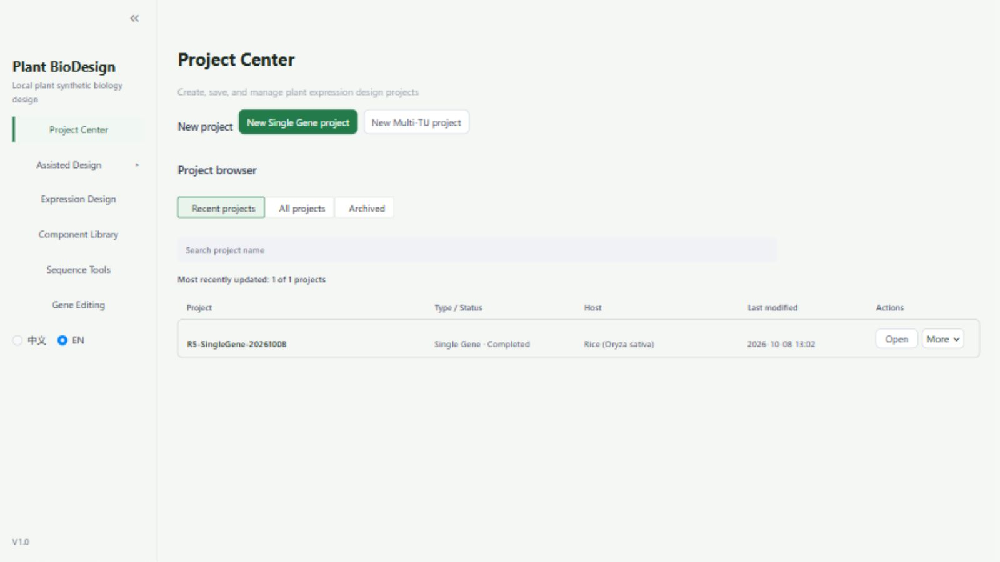
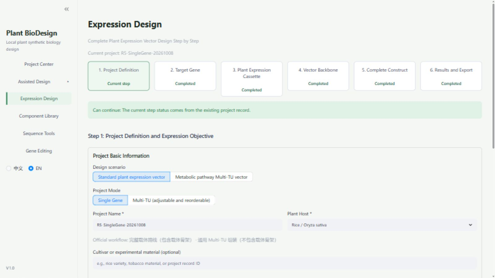
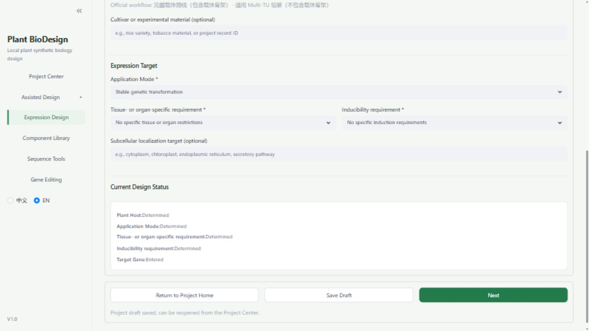
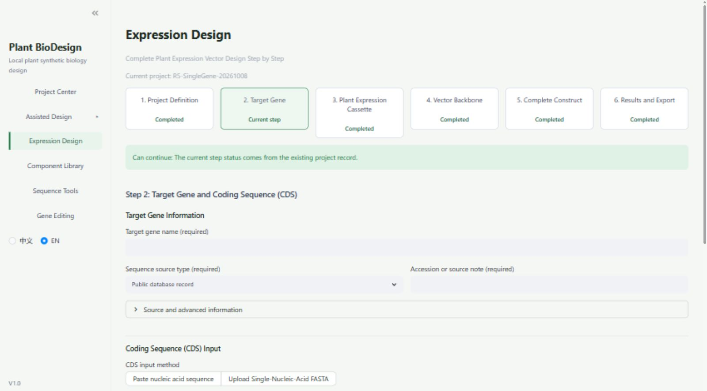
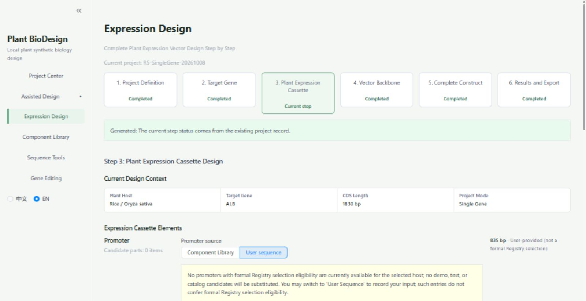
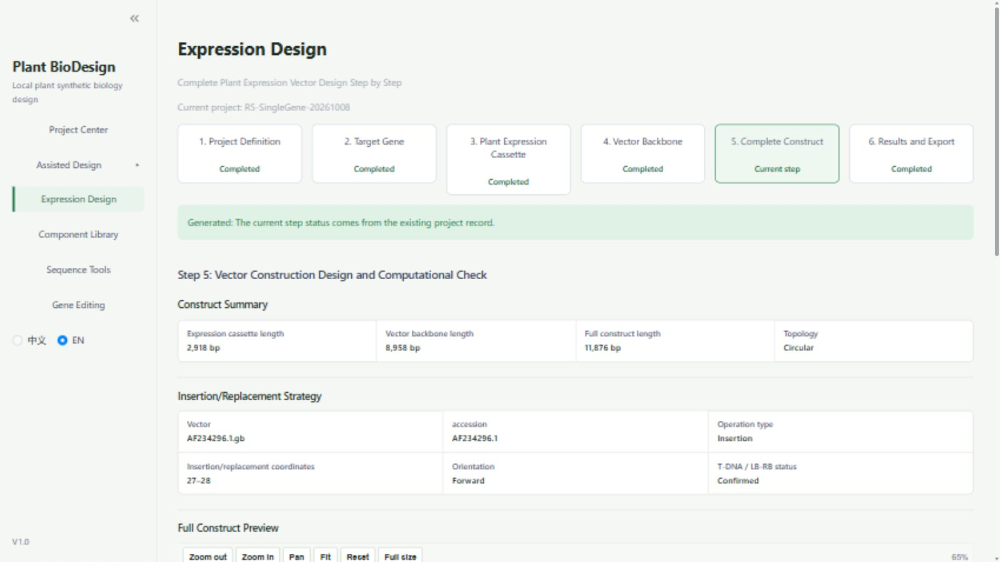
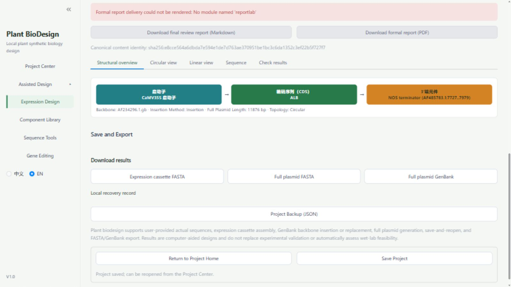
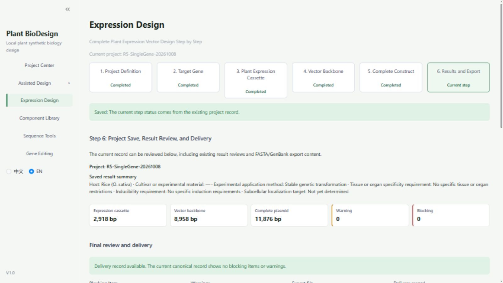

# PlantBioDesign V1.0 中文使用手册

中文 R4 正式公开文档 · 2026-10-10

署名：PlantBioDesign。本手册面向植物学、生物学和合成生物学研究者，依次介绍用途、安装、六步设计、保存与导出。版本差异和详细历史判定集中在第14章附录。

本 R4 文档作为英文 R1.2 的中文翻译基准。

论文分析所依据的冻结投稿源码提交为 `8ead74c060c32e653e746030e557398637a2c2fc`。本手册 ALB 操作使用的 GitHub 分发快照为 `176232bdd20eb0ae987b52ad8b84df1f71b35a39`；该快照的 `SOFTWARE_SNAPSHOT.md` 将其来源标为上述投稿源码。两者分别标识论文源码与 GitHub 分发对象，不据此声称两个提交逐文件等价；ALB 操作记录不扩展论文 MT-01/MT-02 的验证范围。

本手册 ALB 操作章节中沿用的“冻结版”称谓指上述分发快照内的软件操作基线，不将其提交身份视为论文冻结投稿源码。

本轮截图取自固定提交的独立运行副本和历史 R5 ALB 数据库副本。正文的历史生成结论不变；新增图只证明本轮实际可见内容。完整操作截图仍有缺口，不能视为公开验收通过。

## 阅读导航

1. 软件简介

2. Windows 下载、安装和启动

3. 软件首页与项目中心

4. 创建单基因项目

5. 单基因六步设计怎么走

6. 植物宿主与目标基因输入（第 1–2 步）

7. 元件库与启动子、终止子选择（第 3 步）

8. 载体骨架选择与正式使用限制（第 4 步）

9. 完整构建、结果与质粒图（第 5–6 步）

10. 保存项目与重新打开

11. FASTA 和 GenBank 下载

12. 正式报告生成与当前限制

13. 常见问题与故障解决

14. 软件版本、参考资料与 GitHub


## 1. 软件简介

PlantBioDesign（页面显示为 Plant BioDesign，部分历史说明称 BioDesign Studio）用于整理植物表达载体设计：记录宿主和基因来源、组成表达盒、选择允许使用的骨架、查看计算生成的质粒，并保存和下载设计记录。

“表达盒”在本案例中指启动子、编码序列（CDS）和终止子组成的 DNA 片段；“完整质粒”还包括载体骨架。软件结果用于设计文档和人工复核，不证明植物表达成功、实验安全或可直接进行实验。R5 没有提供湿实验数据。


### 1.1 主要功能与适用范围

软件将宿主、目标基因、调控元件、骨架、完整构建和导出记录串联为六步流程，适用于植物表达构建的计算设计、来源整理与人工复核。本手册实际操作范围为水稻宿主的人 ALB 单基因案例，采用用户序列和指定骨架上传路线。其他入口的存在不代表已验证。

本 ALB 单基因操作例是独立操作示例，不是论文 MT-01 或 MT-02 的结果。论文案例分别为 4079 bp 双转录单元和 6609 bp 三转录单元来源区域，均未证明独立完整质粒重建。

论文的逐位一致仅限指定来源区域及其序列导出；本 ALB 案例的序列核验按各轮已列明的范围解释，不覆盖完整质粒独立重建能力、全部注释、正式报告或湿实验验证。

已有记录支持本案例的表达盒和完整质粒生成、保存后重开查看及序列下载；正式报告下载、骨架目录选择、来源汇总和重开编辑存在限制，详见第10–12章。未采纳候选的改进不属于本手册对应的 V1.0 功能。

## 2. Windows 下载、安装和启动

### 2.1 适用环境与下载

论文分析所依据的冻结投稿源码提交为 `8ead74c060c32e653e746030e557398637a2c2fc`。本手册 ALB 操作使用的 GitHub 分发快照为 `176232bdd20eb0ae987b52ad8b84df1f71b35a39`；该快照的 `SOFTWARE_SNAPSHOT.md` 将其来源标为上述投稿源码。两者分别标识论文源码与 GitHub 分发对象，不据此声称两个提交逐文件等价；ALB 操作记录不扩展论文 MT-01/MT-02 的验证范围。

已有 R4 记录验证了 Windows x64、Python 3.12.10、固定提交和锁定安装；本手册任务不重复安装审计。尚无本任务证据支持“下载后双击 EXE 即可用”，这里说明 Python 启动方式。

打开 [GitHub 仓库](https://github.com/1176719502/PlantBioDesign)。为避免下载到后续变化的代码，使用 [本手册 ALB 操作所用 GitHub 分发快照 ZIP](https://github.com/1176719502/PlantBioDesign/archive/176232bdd20eb0ae987b52ad8b84df1f71b35a39.zip)，保存后右键“全部解压”。进入解压出的文件夹，应看到 `software` 文件夹。固定 ZIP 的浏览器下载和“全部解压”步骤本任务没有另行实测；已验证安装取自 R4 的同一固定提交检出副本，不应把这两条取得文件的途径混为同一次验收。

准备 Windows x64 版 CPython 3.12；已有记录实际验证的是 CPython 3.12.10。打开 [官方下载页](https://www.python.org/downloads/windows/) 后确认系统可以使用 `py -3.12`。32 位或 ARM 解释器没有本手册的通过证据。以下命令放在 PowerShell 中执行。它们是依据已有启动方式整理的可复制说明，本任务仅检查语法与路径逻辑，不实际下载、安装或启动冻结软件。

### 2.2 安装运行环境

在解压后、包含 `software` 的文件夹内打开 PowerShell，依次复制执行下面整块命令。环境和项目数据放到独立的 `C:\PlantBioDesignReview`，不写进软件源文件夹。

```powershell
$ErrorActionPreference = 'Stop'
$manualSoftware = Join-Path (Get-Location).Path 'software'
if (-not (Test-Path -LiteralPath (Join-Path $manualSoftware 'app.py'))) {
    throw '请先在包含 software 文件夹的解压目录中打开 PowerShell。'
}
$manualRoot = 'C:\PlantBioDesignReview'
$manualEnv = Join-Path $manualRoot 'env-v1-frozen'
New-Item -ItemType Directory -Path $manualRoot -Force | Out-Null
py -3.12 --version
if ($LASTEXITCODE -ne 0) { throw '未找到 Python 3.12，请先完成安装。' }
@'
import platform, struct, sys

print(
    platform.python_implementation(), platform.machine(), struct.calcsize("P") * 8
)
sys.exit(
    0
    if platform.python_implementation() == "CPython"
    and platform.machine().lower() in ("amd64", "x86_64")
    and struct.calcsize("P") == 8
    else 1
)
'@ | py -3.12 -
if ($LASTEXITCODE -ne 0) { throw '本锁定环境要求 Windows x64 / 64 位 CPython 3.12；当前解释器架构不匹配。' }
if (Test-Path -LiteralPath $manualEnv) {
    throw '安装目录已存在；已有环境请使用下一节启动，不要覆盖。'
}
py -3.12 -m venv $manualEnv
if ($LASTEXITCODE -ne 0) { throw '运行环境创建失败。' }
$manualPython = Join-Path $manualEnv 'Scripts\python.exe'
& $manualPython -m pip install --only-binary=:all: --require-hashes -r (Join-Path $manualSoftware `
'requirements-runtime.lock')
if ($LASTEXITCODE -ne 0) { throw '安装失败；保留完整错误信息，并按下方“安装失败重试”操作，不要直接重复整块命令。' }
& $manualPython -m pip check
if ($LASTEXITCODE -ne 0) { throw '依赖检查未通过，暂不启动。' }
```

`requirements-runtime.lock` 是记录包版本和文件校验值的安装清单。不要随意换成历史 `requirements.txt`，也不要认为安装成功就代表全部功能通过：冻结清单缺少报告所需的 ReportLab，R5 的两种正式报告下载均因此被阻断（见第 12 节）。此处不提供对冻结环境临时补装的“修复”命令。

**安装失败重试。** 如果创建 venv 后依赖安装失败，目录存在并不表示环境可启动；不要直接重复会被目录门槛拦截的整块安装命令。在同一源码版本、同一根目录配置下，对已有隔离解释器执行：

```powershell
$ErrorActionPreference = 'Stop'
$manualSoftware = Join-Path (Get-Location).Path 'software'
$manualRoot = 'C:\PlantBioDesignReview' # 若上方改过根目录，这里保持相同
$manualPython = Join-Path $manualRoot 'env-v1-frozen\Scripts\python.exe'
if (-not (Test-Path -LiteralPath $manualPython)) { throw '解释器尚未创建成功，请保留创建环境的错误信息。' }
if (-not (Test-Path -LiteralPath (Join-Path $manualSoftware 'requirements-runtime.lock'))) { throw `
'请返回包含 software 的固定源码解压目录。' }
& $manualPython -m pip install --only-binary=:all: --require-hashes -r (Join-Path $manualSoftware `
'requirements-runtime.lock')
if ($LASTEXITCODE -ne 0) { throw '锁定依赖重试失败；保存完整日志并停止。' }
& $manualPython -m pip check
if ($LASTEXITCODE -ne 0) { throw '依赖检查失败；暂不启动。' }
```

只有安装命令和 `pip check` 都成功才继续；这些命令的语法与控制流已检查，但本轮未进行安装故障实机回放。不要删运行数据、取消哈希校验或补装未声明包。

**目录权限。** 如果 `C:\PlantBioDesignReview` 创建时被拒绝，可选自己的可写目录，例如将各块中的 `$manualRoot` 都设为 `Join-Path ([Environment]::GetFolderPath('MyDocuments')) 'PlantBioDesignReview'`。安装、重试、启动的根目录必须一致；已有项目以后仍使用原 runtime。权限是否受限依本机 ACL 和组织策略而定，这不是已实测的普遍失败，不需要默认以管理员运行。环境变量命令在专用 PowerShell 窗口执行。

### 2.3 启动和以后重新启动

每次启动都在包含 `software` 的解压目录打开 PowerShell，执行下面整块命令。保持窗口打开，等出现本地地址后再在浏览器中打开 [http://127.0.0.1:8634](http://127.0.0.1:8634)。`127.0.0.1` 指本机，8634 是本手册使用的访问端口。

```powershell
$ErrorActionPreference = 'Stop'
$manualSoftware = Join-Path (Get-Location).Path 'software'
$manualRoot = 'C:\PlantBioDesignReview' # 与安装/重试相同
$manualPython = Join-Path $manualRoot 'env-v1-frozen\Scripts\python.exe'
$manualRuntime = Join-Path $manualRoot 'runtime-v1-frozen'
if (-not (Test-Path -LiteralPath $manualPython)) { throw '请先完成安装。' }
if (-not (Test-Path -LiteralPath (Join-Path $manualSoftware 'app.py'))) {
    throw '当前文件夹不正确，请返回包含 software 的解压目录。'
}
$manualPort = 8634
if (Get-NetTCPConnection -LocalPort $manualPort -State Listen -ErrorAction SilentlyContinue) {
    throw "$manualPort 已被占用；请先确认是否为自己的软件窗口，不要停止未知进程。"
}
New-Item -ItemType Directory -Path $manualRuntime -Force | Out-Null
$env:BIODESIGN_DB_PATH = Join-Path $manualRuntime 'biodesign_unified.db'
$env:BIODESIGN_PLANT_PROJECT_DRAFT_DIR = Join-Path $manualRuntime 'project_drafts'
$env:BIODESIGN_BACKUP_DIR = Join-Path $manualRuntime 'backups'
$env:BIODESIGN_PYDNA_CONFIG_DIR = Join-Path $manualRuntime 'pydna\config'
$env:BIODESIGN_PYDNA_DATA_DIR = Join-Path $manualRuntime 'pydna\data'
$env:BIODESIGN_PYDNA_LOG_DIR = Join-Path $manualRuntime 'pydna\logs'
$env:LOCALAPPDATA = Join-Path $manualRuntime 'local-app-data'
$env:PYTHONDONTWRITEBYTECODE = '1'
Push-Location -LiteralPath $manualSoftware
try {
    & $manualPython -m streamlit run app.py --server.address 127.0.0.1 --server.port $manualPort `
--server.headless true --server.fileWatcherType none
} finally {
    Pop-Location
}
```

先保存项目，再在这个 PowerShell 窗口按 `Ctrl+C` 停止自己启动的软件。以后使用相同软件版本和同一 `runtime-v1-frozen` 目录启动，才能找回这里保存的项目。若更换端口，必须同时修改 `$manualPort`、占用检查、`--server.port` 和浏览器 URL；不要自动停止未知进程。上述访问地址与目录是本手册给普通用户安排的新路径，不是 R5 原审计数据库。

历史说明还出现 8528（开发运行）和 8632（审稿包）；R4 使用 8633，R5 使用 8634，R5.2A 候选使用 8636。端口不同不表示软件升级。不要在多个实例间混用项目数据，也不要把开发实例当成本手册的冻结版本。

## 3. 软件首页与项目中心

1. 点击左侧 `Project Center`。
2. 点击 `New Single Gene project` 或 `New Multi-TU project`。
3. 在项目浏览器使用 `Recent projects`、`All projects`、`Archived` 和 `Search project name`。
4. 已保存项目点击 `Open`，其他操作点击 `More`。

其中 `New Multi-TU project` 和 `More` 仅作为原有可见入口介绍，不展开为本稿已经验收的操作。既有记录确认单基因入口可进入第1步，并完成本例操作、保存重开查看和序列导出。




左侧主要入口按实际页面理解如下。

| 页面文字 | 中文含义与本手册覆盖 |
| --- | --- |
| Project Center | 项目中心；新建和重开项目，R5 实测 |
| Expression Design | 表达设计；本手册的单基因六步流程，R5 实测 |
| Component Library | 元件库；第 3 步资格提示已观察到，独立元件库浏览、筛选全流程暂未验证 |
| Assisted Design | 辅助设计；入口可见，本手册没有完成其操作验收 |
| Sequence Tools | 序列工具；入口可见，本手册暂未验证 |
| Gene Editing | 基因编辑；入口可见，本手册暂未验证 |

左下可见 `中文` 与 `EN`。R5 截图采用 EN，本文解释成中文，实际控件保留英文用于对照；英文模式仍有中文标签和少量未翻译文字。没有完整中文界面逐步回归证据，不保证每个中文按钮与本文译法完全相同。

## 4. 创建单基因项目

1. 在项目中心点击 `New Single Gene project`（新建单基因项目），进入 `Expression Design`。
2. 在第 1 步选择 `Standard plant expression vector`（标准植物表达载体）及 `Single Gene`（单基因）。
3. 填项目名和宿主。R5 示例名为 `R5-SingleGene-20261008`，宿主为 `Rice / Oryza sativa`（水稻）；新项目请用自己的名称。
4. 填写当前页必需的表达目标；可选的品种或实验材料若没有信息，可留空，不编造结果。

如果刷新后仍停在设计页，这可能是同一会话被保留。使用 `Return to Project Home`（返回项目首页）回到项目中心，再决定新建还是打开已有项目；刷新本身不等于新建空项目。（依据：R4 入口诊断与 R5 六步记录。）







## 5. 单基因六步设计怎么走

按顺序完成下表。各步的 `Next`（下一步）只有在当前条件满足时才可用。改动输入后可能需要重新分析或生成，不能沿用旧结果。

| 步骤 | 你要完成的事 | R5 真实结果与后文位置 |
| --- | --- | --- |
| 1. Project Definition | 项目定义、宿主和表达目标 | 本案例完成；第 4、6 节 |
| 2. Target Gene | 输入基因 CDS，写明来源，分析并确认 | 本案例完成；第 6 节 |
| 3. Plant Expression Cassette | 选择或输入启动子、3′端元件，确认排列并生成 | 用户序列路线完成，2918 bp；第 7 节 |
| 4. Vector Backbone | 核对骨架及允许的插入方案 | 目录失败；真实 GenBank 上传路线完成；第 8 节 |
| 5. Complete Construct | 生成完整质粒、检查结果与图谱 | 本案例生成 11876 bp 环状质粒；第 9 节 |
| 6. Results and Export | 保存、复核、下载序列和报告 | 序列及保存成功，冻结报告阻断；第 10–12 节 |

“Completed”是页面步骤状态，“Saved”是保存状态；“0 warnings”或“Deliverable”也不能替代实际文件检查。R5 已到第 6 步，但整体并未通过验收。

## 6. 植物宿主与目标基因输入（第 1–2 步）

### 6.1 宿主和表达目标

宿主是计划表达外源基因的植物，不一定等于基因的来源物种。R5 的宿主是水稻，ALB 基因来源是人（Homo sapiens）。两者不同不是填写错误，也不能由此推出水稻表达效果。

R5 第 1 步设置：稳定遗传转化（`Stable genetic transformation`）、无特定组织或器官限制、无特定诱导要求、亚细胞定位尚未确定。按你的真实设计目标填写；不要把示例设置自动用于其他研究。其他宿主、表达目标组合和整条设计路线不在本稿的已验证范围。

### 6.2 输入并核对 CDS

1. 进入 `Target Gene`。基因名填 `ALB`，来源类型选择 `Public database record`（公共数据库记录）。
2. 在 `Accession or source note (required)`（编号或来源说明，必填）填写记录版本、来源物种和坐标。R5 使用 `NM_000477.7`，人 ALB，正链 `42..1871`。
3. 展开 `Source and advanced information`（来源与高级信息），核对基因符号、来源物种及修改状态。本例为 `Unmodified source sequence`（未修改的来源序列），不勾选 `This input is a partial CDS`（这是一段不完整 CDS）。
4. 使用粘贴核酸序列方式，粘贴实际 CDS 或带名称行的 FASTA。FASTA 第一行以 `>` 开头，下面是核酸序列；名称行不是核酸本身。不要用完整转录本、蛋白序列或仅有名称的空记录代替本例 CDS。
5. 输入后页面自动形成分析预览，核对长度、单条记录、A/C/G/T 字符、阅读框、起始/末端密码子和内部终止密码子等检查。可展开 `CDS completeness checklist`（CDS 完整性检查表）查看详细项目；按提示解决阻断项，不擅自删改序列来消除提示。
6. 点击 `Confirm CDS and continue`（确认 CDS 并继续），保存当前分析并进入第 3 步。若修改输入后显示需要复核，重新检查当前预览后再确认；完整 CDS、本例来源说明和 1830 bp 应一致。这些按钮与分析预览的说明已只读核对冻结源码和英文语言文件，原截图没有完整覆盖这些控件；本例实际完成仍由 R5 操作记录、后续步骤状态和导出共同证实。




> 证据限制：历史来源输入竖图（889×1244 px）已移出正文。此真实横向画面仅证明同一 ALB 项目重开后，基因名与来源字段为空；Can continue 来自已有保存记录，不证明输入完整恢复或本轮操作成功。本轮未补填、确认或重新生成。

R5 原始输入已经保存，但复现不能依赖本机路径。请按 [案例输入复现说明](CASE_INPUT_REPRODUCIBILITY.md) 从 NCBI 获取三个带版本的 GenBank 记录，再按坐标和方向提取；该说明同时给出文件 SHA-256、核酸 SHA-256、标准化规则和最终结果校验。复现说明使用标准工具和可审查短命令，无需项目专有辅助脚本；本公开文档包不随附 GenBank 原文、FASTA、序列 JSON 或完整衍生构建。

| 材料 | R5 已保存的本机文件 | 已记录长度 |
| --- | --- | ---: |
| ALB CDS | `ALB_NM_000477.7_cds.fasta`（历史输入文件名，不随附） | 1830 bp |
| CaMV 35S | `CaMV35S_AF485783_4974_5808.fasta`（历史输入文件名，不随附） | 835 bp |
| NOS 终止子 | `NOS_AF485783_7727_7979.fasta`（历史输入文件名，不随附） | 253 bp |
| pCAMBIA-1300 骨架 | `AF234296.1.gb`（历史输入文件名，不随附） | 8958 bp |

输入记录可由公众依法独立取得，但获取记录不等于软件来源审核或生物学批准。软件不会因为写了 accession 就自动保证序列身份正确。R5 的启动子、终止子仍以用户序列输入，来源汇总未闭合；本节教程只证明可重复取得和核酸身份，不把它们升级为正式库资格或完整来源认证。

## 7. 元件库与启动子、终止子选择（第 3 步）

点击 `Component Library`，按实际页面核对来源、元件、方向、版本和人工确认状态。独立元件库页面的完整交互仍暂未验证。本节已验证的是六步设计中第 3 步的实际选择提示和用户序列路线。

1. 在第 3 步查看启动子与 `3′ Regulatory Element`（3′端调控元件）的来源选项。若选 `Component Library`，先读正式选择资格提示；没有符合条件的元件时不要用演示条目替代。
2. R5 所选水稻条件下，页面提示没有可正式选择的相应元件。切换为 `User sequence`（用户序列），分别输入名称及真实 DNA/FASTA。启动子写 `CaMV 35S promoter (AF485783.1:4974..5808)`，终止子写 `NOS terminator (AF485783.1:7727..7979)`。
3. 在 3′端元件的生物学角色中，本例选 `Transcription terminator`（转录终止子）。CDS 来自第 2 步；新建过程修改 CDS 需按提示重新分析。对重开项目，先读第 10.1 节的 1→2→3 导航限制，不承诺返回后能恢复编辑。
4. 本例不添加可选元件。核对顺序为“启动子 → ALB CDS → NOS 终止子”，确认方向，再勾选 `I have confirmed the component arrangement and orientation`（已确认元件排列和方向）。
5. 处理页面阻断项后点击 `Generate expression cassette`（生成表达盒）。生成后核对结果，R5 为 2918 bp，再点击 `Next`。




> 图4a与图4b为真实局部取景，二者之间有未展示区域，不能视为连续完整覆盖。Generated 来自保存记录，本轮未重新生成表达盒。


> 横向局部证据：保留方向确认、检查摘要及 Next；未展示完整序列输入区。图4a与图4b不能证明完整输入或生成操作链。

第3步截图仍不完整：输入序列区未新增公开；图4a与4b之间存在有意保留的取景缺口，不能称为完整连续覆盖。Generated 来自保存记录，本轮未重新生成表达盒。

R5 长度核对：835 bp 启动子 + 1830 bp CDS + 253 bp 终止子 = 2918 bp。这个相加关系只适用于本例无额外元件的构建。

**用户序列被接受不等于元件已经取得库内正式资格。** 排列和方向确认也不是来源审查。启动子和终止子详细来源仍显示“用户提供，待确认”，顶层来源汇总又显示“未提供”；目前需要独立保留原始来源说明。

## 8. 载体骨架选择与正式使用限制（第 4 步）

### 8.1 先核对目录状态

完成表达盒后进入 `Vector Backbone`。R5 的 `pCAMBIA-1300 / AF234296.1` 显示 `Officially available`（正式可用），但实际点击 `Select`（选择）后报错：

> Catalog asset pcambia1300_af234296_1 source record cannot be read.

这是冻结分发副本缺少目录引用的本地源记录，并非本 ALB 案例被正式资格规则拒绝。R5.1 已定位原因，冻结版和 R5.2A 报告候选均没有修复该目录问题。标签“正式可用”不能保证文件实际可读。

### 8.2 本例已验证的上传途径

1. 仅在持有允许本次使用的真实完整骨架记录时，选择 `Upload GenBank file`（上传 GenBank 文件）。
2. 用 `Browse files`（浏览文件）选择真实 `AF234296.1.gb`。页面支持单条记录 `.gb`、`.gbk`、`.genbank`，界面标示上限 50 MB；R5 只验证了本例 `.gb`，没有验证全部格式和大小边界。
3. 核对页面识别为 AF234296.1、8958 bp、`Circular`（环状），并显示自动应用固定插入规则。
4. 核对外部边界 `27|28`：在原骨架第 27 与第 28 个碱基之间插入。程序内部索引是 27，普通用户无需换算或填写任意坐标。本路线不提供标准反向插入，也不接受任意坐标。
5. 确认上述身份与固定规则后，点击 `Confirm backbone and continue`（确认骨架并继续）进入第 5 步；该按钮名已只读核对冻结源码和英文语言文件，本轮图 5 已完整覆盖恢复的合同与按钮，但不是本轮重新上传的证据。R5 成功上传不代表目录 Select 已通过。


> 此图展示重开后已有骨架记录，未重新上传或确认；确认按钮与 Next 禁用状态均保留。

本轮只查看保存的骨架记录，未重新上传 GenBank 或点击确认；真实上传成功属于历史 R5 操作证据。

R5 对应的正式路线是 `single_gene_rice_alb`（水稻 ALB 单基因）。不要把同一骨架任意推广到其他宿主、基因或 Multi-TU 项目。pBI121 在此页是其他固定工作流的受限条目；pBIN19 和 r229 本地示例在此页没有可用正式操作规则，不能作为本例的替代骨架。任意 GenBank 上传不会自动取得正式构建资格。请保留软件的不可选与阻断提示，不通过改文件名或编辑软件规则绕过。

## 9. 完整构建、结果与质粒图（第 5–6 步）

1. 第 5 步核对表达盒、骨架、插入位置、方向及 T-DNA 边界状态。
2. 点击 `Generate full vector`（生成完整载体）；该按钮名已只读核对冻结源码和英文语言文件，R5 截图记录的是生成后的视区。生成条件不满足时先处理提示，不要把仍待审查或过期的结果当作当前构建。
3. R5 生成了 11876 bp 环状质粒，正向插入，计算检查显示 0 个阻断项、0 个警告。该长度等于 8958 + 2918 bp；已有独立比较确认序列按固定边界插入。
4. 阅读 `Full Construct Preview`（完整构建预览）的质粒图。图中显示项目名、总长度、骨架及插入片段注释；以下为历史R5生成结果的本轮重开查看截图，不代表本轮重新生成。
5. 点击 `Next` 进入第 6 步。在 `Structural overview`（结构概览）检查元件顺序和结果摘要；页面还显示 `Circular view`、`Linear view`、`Sequence`、`Check results` 标签。这些标签存在已确认，但 R5 没有逐项完整点击验收，不能保证每项图形和操作均通过。





> 软件内部图谱比例为76%，界面取景未补绘。更小的图谱标签请参阅图6c的原生导出图。


> 软件原生导出图，非界面截图；保持3000×2000像素和原有标签、引线及交叉，不裁切、不重绘。


> 横向局部证据：完整保留本视区的计算检查、下载及 Next 按钮。图谱 PNG 下载已有上一轮实际证据；SVG/PDF下载仍为 NOT_PROVEN。

本轮实际使用 Full size、Fit 和一次 Zoom in，并验证图谱 PNG 下载落盘；图6b、6c均无边界裁切，原生PNG用于阅读完整标签。SVG/PDF图谱下载、Pan、Reset未完整验收，仍为 NOT_PROVEN。图谱中原有引线与圆环邻近标签的交叉保持原样，完整可见不代表注释生物学正确。序列下载另见第11节。

计算检查不代替生物学功能、注释质量或实验适用性审查。特别是“0 warning”不会自动纠正第 7 节的来源信息缺口。

## 10. 保存项目与重新打开

已有操作记录支持：本 ALB 案例的保存、程序重启后重开及核心序列保留已验证，来源汇总完整性仍未通过。

1. 设计中可见 `Save Draft`（保存草稿）；阶段性记录可以用它保存。R5 留有保存草稿提示，但没有独立验证每一步草稿在所有中断情形下都能恢复。
2. 到第 6 步点击 `Save Project`（保存项目）。等看到 `Project saved; can be reopened from the Project Center.`（项目已保存，可从项目中心重新打开），再离开页面。
3. 下载 `Project Backup (JSON)`（项目备份），保存在自己的项目文件夹。它是额外的记录备份，不是 FASTA、GenBank 或正式报告；JSON 导入与灾后恢复路线本稿暂未验证。
4. 从项目中心找到同一项目，点击 `Open`（打开）。可以按项目名查找，也可以用原稿介绍的 `Recent projects`（最近项目）、`All projects`（全部项目）、`Archived`（已归档）范围查找；归档操作及恢复没有完整验收。
5. 重新打开后核对项目名、宿主、基因名、各元件、骨架和三个长度。**已保存项目重新打开后，可能从第1步开始；不要把它视为保存失败，也不要假定总会回到第6步。** R5原案例的特定截图记录了程序重启、新会话重开后第1–5步显示 `Completed`、第6步显示 `Current step`，并有 `Saved` 横幅；这张截图不是所有项目的重开落点保证。第二步输入框也可能为空，先读第10.1节。




> 已保存提示来自历史项目记录，不证明本轮新保存成功；报告错误原样保留。




> 六步与 Saved 状态来自历史保存记录，不能据此推断六步输入已完整恢复。

本轮打开历史保存项目的隔离副本，未重新执行保存；图7、8的保存状态来自原项目记录，不作为本轮新保存成功证明。

### 10.1 重开编辑与来源汇总限制

已验证案例中，重开第2步后，基因名、来源说明和粘贴 CDS 输入框没有正确显示保存值，旁边却仍显示1830 bp及 `Matches saved CDS`。基因名、详细来源、原始 FASTA 和核酸仍在项目草稿 JSON 中；这不是 SQLite 项目历史表保存路线。空输入框不能据此判为序列丢失，也不能认定备份所有字段不变。

点击确认或操作输入框可能回传空值，将未实际改动的设计标为需要复核；修改第1步实验材料也曾触发历史只读预览。按第1→2→3步重访后，可退回 `Results & Export (Historical Results Preview)`，无法继续正常编辑。直接重访第3–5步在触发前曾可显示保存结果，但不是触发后的恢复方案。

**冻结 V1.0 尚无已验证的完整编辑恢复方法。** 刷新、再次打开、JSON导入、重新确认第1步或修改数据库均不能作为已验证解决方法；`Return to Project Home` 控件可见也不证明编辑状态恢复。故障在冻结版与候选对照中均有观察，不能归为报告候选新引入，也不能推广为所有项目必然发生。

若无法正常编辑，先保留可取得的 JSON、FASTA、GenBank、错误文字、截图和日志，停止覆盖原数据；向维护者提供版本、端口和运行目录，分享前确认序列权限。根因与未采纳候选信息集中于第14章附录。

本例 ALB 的 `NM_000477.7` 详细来源仍保存，但汇总引用显示 `not_provided`；启动子和终止子也被汇总为未提供。应另外保存 accession、版本、坐标、原始文件和来源说明。

保存前后 JSON 大小和哈希不同，部分来自新增恢复字段；不能据此认定核酸损坏。历史记录显示三份序列导出重开前后内容一致，但不证明 JSON 所有字段完全相同。

## 11. FASTA 和 GenBank 下载

在第 6 步的 `Save and Export`（保存与导出）区，分别点击下列真实按钮。确认浏览器下载完成，再打开实际文件；不要只看按钮可点。

| 按钮 | 文件用途 | R5 已验证结果 |
| --- | --- | --- |
| Expression cassette FASTA | 只含表达盒序列 | 2918 bp；重开前后相同 |
| Full plasmid FASTA | 完整质粒核酸序列 | 11876 bp；重开前后相同 |
| Full plasmid GenBank | 完整质粒序列及注释 | 11876 bp、20 个 features；重开前后相同 |
| Project Backup (JSON) | 项目记录备份 | 能下载；核心记录保留，来源汇总有缺口 |

按钮位置见图 7。下载文件通常在浏览器“下载”位置，也可以按浏览器设置另存。R5 的完整质粒文件名以 `complete_plasmid_26399b187adc487a` 开头，后缀为 `.fasta` 或 `.gb`；表达盒以 `construct-...` 开头；JSON 为 `project_backup.json`。项目与内容不同会改变文件名，重复下载可能加 `(1)`，不要硬编码所有项目都用同一名称。

R5 实际解析确认：完整质粒 FASTA 和 GenBank 的核酸逐字符相同，保存重开后仍相同；GenBank 注释前后一致。没有对所有注释的生物学正确性作独立认证。

可供审查者对照的本例核酸 SHA-256（可理解为序列指纹）：

| 对象 | 已有验证值 |
| --- | --- |
| 表达盒核酸序列 | `8422558a6f117fb27debb3fc96ad3b954e22de904c0e48fe7eece447413bac7f` |
| 完整质粒核酸序列 | `26399b187adc487ac7cdc2f56bf260a35175f8970f29de6349cd99ceecc1667c` |

这里的序列指纹只计算核酸，不包括 FASTA 名称行、换行和 GenBank 注释；Windows 文件校验得到的是完整文件指纹，两者不能直接比较。历史文件字节校验值保存在原导出一致性报告中，未在本公开文档附载；自行下载的原始响应和实际导出应另行记录文件字节SHA-256。

## 12. 正式报告生成与当前限制

### 12.1 冻结 V1.0：两种报告均被阻断

第 6 步可见 `Formal report preview`（正式报告预览）、`Download final review report (Markdown)` 和 `Download formal report (PDF)`。在 R5 原锁定环境，两种下载按钮均禁用，实际报错为：

> Formal report delivery could not be rendered: No module named 'reportlab'


> 横向故障证据：完整保留错误文字及禁用下载按钮；不作为报告成功生成或下载的证明。

R5.1 已确认：运行安装清单缺少 ReportLab；冻结界面把 Markdown 和 PDF 放在同一错误处理中，PDF 模块导入失败会把两种下载一起禁用。隔离诊断能生成 4 页 PDF，但诊断文件不能冒充冻结界面真实下载结果。冻结软件报告与序列的三者一致性仍未证实。

### 12.2 对用户的影响

保存可取得的序列和项目备份，并单独记录来源，不把界面“Deliverable”或“0 warnings”当作全部交付成功。本文档 PDF 是独立排版的用户说明，不是软件成功生成正式报告的证据。

已有报告修复候选曾在限定范围完成下载和故障隔离核验，但尚未采纳；冻结 V1.0 的报告阻断、来源缺口和编辑恢复限制仍保留。版本及详细历史判定见第14章附录 A。本手册不提供替换冻结代码或临时补装依赖的步骤。

## 13. 常见问题与故障解决

| 现象 | 解释与处理 | 已有证据范围 |
| --- | --- | --- |
| 未找到 Python 3.12 | 用安装命令中的版本检查确认；安装正确版本后再建环境 | R4 实测版本为 3.12.10；其他版本未覆盖 |
| 安装失败或网络错误 | 保留整段错误；若 venv 已创建，按第 2.2 节对现有解释器重新执行同一哈希锁安装并 `pip check`，不要直接重复会被目录门槛拦截的整块命令；仍失败就停止并保存证据 | 失败后目录门槛与启动检查的控制流已由静态证据确认；未把每种网络故障当作实测 |
| 浏览器打不开本地地址 | 确认启动窗口仍在运行、没有报错，地址与端口相同；保存启动窗口错误供维护者核查 | 沿用 R5 启动方式；没有验证全部设备配置 |
| 端口已占用 | 先确认是否是自己已开的软件；不要停止未知进程。经确认可换空闲端口时，同时改 `$manualPort`、占用检测、`--server.port` 和浏览器地址 | R4 遇到 8632 占用而使用 8633，不是软件升级 |
| 刷新后没有回到首页 | 当前会话可能保留，点 Return to Project Home 后再新建或打开 | R4 重复操作记录 |
| Next 禁用、Needs correction | 阅读当前步的必填项、确认项和阻断提示；改完后重新分析或生成 | R5 第 2–3 步与后续完成状态 |
| 元件库显示 0 个候选 | 是当前条件下缺少符合正式选择资格的条目；有真实材料时可用用户序列，来源责任仍需保留 | R5 所选水稻条件；不推断所有宿主都为 0 |
| 骨架显示正式可用，Select 却报读取错误 | 目录缺少引用文件；记录错误。有允许使用的真实 AF234296.1 时可按第 8 节上传 | 目录失败与本例上传成功已验证；不是通用修复 |
| 上传骨架后仍不能继续 | 格式、身份或当前工作流可能不符合规则；按提示核对原记录，不改文件名绕过 | 限定 ALB 骨架成功；其他失败的具体原因不能在无日志时断言 |
| 项目重开后来源显示未提供 | 详细来源可能仍在，而汇总不完整；保留原始文件、来源说明和 JSON，提交维护者核查 | R5/R5.1 证实映射不一致，不是“所有来源全丢” |
| 正式报告两个按钮均灰色 | 冻结 R5 的 ReportLab 缺失与共同错误处理导致阻断；保存序列及备份，记录错误，等待审查后的修订版 | 不提供修改冻结环境的临时补装步骤 |
| 下载重复文件出现 (1) | 浏览器为重名文件加编号；需检查内容，不能只凭名称断定不同序列 | R5 重复下载序列一致 |
| JSON 大小变了 | 恢复相关字段可能改变；不等于序列改变。需要比较关键记录和实际核酸 | R5 核心数据保留；全字段一致未证实 |
| 看不到保存项目 | 确认同一版本、同一启动数据目录及项目查找范围；不要新建数据库覆盖原目录 | R5 同一数据库/草稿目录重启后重开成功 |
| 保存项目重开后从第1步开始 | 可能出现；核对项目身份和已保存结果，不把图 8的第6步当作普遍入口保证 | 重开落点说明保留“可能”，不声称所有项目必然如此 |
| 第二步基因名、来源或CDS框为空，但摘要仍显示1830 bp | 已测项目JSON仍保存完整相应值，界面未正确恢复；不要填空覆盖原值来尝试修复，先保留证据 | R5.2A-R2和R5.2B-0已验证案例；不是所有数据丢失 |
| 确认或编辑后标为已改动并进入历史只读 | 空值回传可能错误触发dirty；真实编辑本应重审，却也可能被只读入口挡住；停止覆盖原记录，参见第10.1节 | R5.2B-0根因已证明但只限受测案例；冻结V1.0无已验证编辑恢复方法 |
| 按 1 → 2 → 3 重访后出现历史只读预览 | 页面会显示 `Results & Export (Historical Results Preview)`；查看/下载可能仍可用，但不能正常继续编辑。保留可取得的JSON、FASTA、GenBank、截图和日志，停止覆盖原记录 | R5.2A候选与冻结对照均出现；冻结V1.0尚无已验证的编辑恢复方法 |
| 质粒图部分标签看不全 | 本轮实际使用 Full size、Fit 和一次 Zoom in，边界标签完整；阅读小标签可用原生PNG | 见图6b/6c；PNG下载已验证，SVG/PDF下载仍NOT_PROVEN |

需要反馈时保存：错误原文、页面截图、项目名、软件固定提交、使用端口及启动窗口日志。含未公开研究序列时先由本人决定可分享范围，不直接提交完整备份。

原稿限制“公开案例合同禁止把完整衍生序列加入仓库”保留其适用边界：冻结 MT-01/MT-02 合同限制完整衍生序列分发。其他例子的软件操作成功不会自动取消该限制；本手册没有重做其来源审计，也没有附加分发这些序列。来源重建、软件导出和生物学验证是不同证据。

本公开文档不包含完整序列、内部日志或历史辅助脚本。第三方资料和序列的权利边界见 [许可与发布范围](LICENSE_MANUAL.md)。


> 与图3复用同一真实画面，集中说明恢复限制；未补填字段或伪造成功状态。


> 历史只读回退是限制证据，不能作为正常第4步操作成功的画面。

## 14. 软件版本、参考资料与 GitHub

| 项目 | 本稿对应信息 |
| --- | --- |
| 手册基稿 | 现有GitHub中文手册及R3候选；本稿为2026-10-09统一公开文档候选 |
| 论文冻结投稿源码 | `8ead74c060c32e653e746030e557398637a2c2fc`；论文分析材料身份 |
| GitHub 分发 / ALB 操作快照 | `176232bdd20eb0ae987b52ad8b84df1f71b35a39`；R4/R5 操作记录基础；来源说明见该快照的 `SOFTWARE_SNAPSHOT.md` |
| 报告修复候选 | `ee85a63a41df890a2981d2da6a83fcb45841633c`；尚未采纳的 R5.2A |
| R5.2A原次独立复审（2026-10-08） | 历史 `R5_2A_INDEPENDENT_REVIEW_NOT_PROVEN` 保留；当时未闭合项按原报告阅读 |
| 后续R5.2A-R2（同日、按轮次） | 报告传输局部GO；证据完整性已检查范围内GO；历史目录零新增NO_GO；完整六步编辑恢复NO_GO；来源引用未闭合；其他新代码回归NOT_PROVEN；整体R5仍未通过 |
| R5.2B-0诊断（同日） | `R5_2B_0_ROOT_CAUSE_PROVEN`；只限已验证案例，不代表已修复 |
| R5.2B-1独立修复候选 | `2dbd3c3f6730f082f5a1a9b0f4c1e97e645144ed`；READY_FOR_REVIEW，未正式采纳，不改冻结结论 |
| GitHub | [1176719502/PlantBioDesign](https://github.com/1176719502/PlantBioDesign) |
| GitHub 分发快照链接 | [ALB 操作分发快照](https://github.com/1176719502/PlantBioDesign/tree/176232bdd20eb0ae987b52ad8b84df1f71b35a39) |

页面左下“V1.0”不足以区分冻结版与本地候选，仍要核对提交和版本说明。

本例序列出处为 [NCBI NM_000477.7](https://www.ncbi.nlm.nih.gov/nuccore/NM_000477.7)、[AF485783.1](https://www.ncbi.nlm.nih.gov/nuccore/AF485783.1) 和 [AF234296.1](https://www.ncbi.nlm.nih.gov/nuccore/AF234296.1)。编号说明记录身份，不替代权限审查；NCBI政策与第三方知识产权也应区分，参见 [Molecular Data Usage](https://www.ncbi.nlm.nih.gov/home/about/policies/#molecular-data)。R2已下载、提取并独立核对四项输入、2918 bp表达盒和11876 bp质粒。历史R2通过结论保留；2026-10-09原复现说明记录已从NCBI重新下载并核对四段输入、2918 bp表达盒和11876 bp序列级重建。原整合轮未复验软件导出与重开流程；本轮截图整改已实际重开历史保存项目，并下载表达盒FASTA、完整质粒FASTA/GenBank及项目JSON，核酸长度与哈希一致。完整六步编辑恢复、GenBank完整qualifiers一致性及JSON导入仍未通过或NOT_PROVEN；取得与提取流程见 [案例输入复现说明](CASE_INPUT_REPRODUCIBILITY.md)，与R2已通过记录一致。这是核酸身份验证，不是分发权、来源资格或生物学功能全面认证。

相关背景文献沿用已核验的 PAPER-01 R1.1 文献表，不用于宣称本例实现下述全部工具或克隆方法：

1. Lescot M. 等. PlantCARE, a database of plant cis-acting regulatory elements and a portal to tools for in silico analysis of promoter sequences. *Nucleic Acids Research*, 2002, 30(1): 325–327. [DOI: 10.1093/nar/30.1.325](https://doi.org/10.1093/nar/30.1.325)。
2. Engler C., Kandzia R., Marillonnet S. A One Pot, One Step, Precision Cloning Method with High Throughput Capability. *PLoS ONE*, 2008, 3(11): e3647. [DOI: 10.1371/journal.pone.0003647](https://doi.org/10.1371/journal.pone.0003647)。
3. Weber E. 等. A Modular Cloning System for Standardized Assembly of Multigene Constructs. *PLoS ONE*, 2011, 6(2): e16765. [DOI: 10.1371/journal.pone.0016765](https://doi.org/10.1371/journal.pone.0016765)。

软件论文的正式引用、作者顺序及 DOI 尚待维护者提供；本稿不编造。

### 附录 A：历史判定与未采纳候选

以下信息用于版本追溯，不是普通用户安装候选或绕过限制的指南。历史操作与序列核验结论均限各自案例和环境；本次截图整改的有限重开查看、下载及图谱取景证据单独列明，不升级历史整体软件验收结果。

### 附录 A.1 R5.2A 候选：报告下载已有真实证据，尚未采纳发布

R5.2A的独立候选补足报告依赖，并让Markdown与PDF分别处理错误。2026-10-08 原次独立最终复审 的 `R5_2A_INDEPENDENT_REVIEW_NOT_PROVEN` 是必须保留的历史判定：当时报告下载等有通过证据，但证据保护、六步编辑恢复及来源完整性未闭合。历史R5目录新增SQLite `db-wal/db-shm` 是该次审查的保护偏差，不归为候选新增软件缺陷。

同日后续 R5.2A-R2最终判定 按对象更新如下；“后续”按审查轮次区分，不能虚构具体时分：

| 判定对象 | R5.2A-R2最终分项判定 | 适用范围 |
| --- | --- | --- |
| 报告传输修复 | **局部GO** | 报告渲染、Markdown/PDF下载、PDF故障隔离及实测序列内容一致性 |
| 证据完整性与原数据库内容可信度 | **已检查范围内GO** | 原主库和原有证据内容哈希稳定；新增辅助文件来源已披露；不覆盖未扫描元数据或并发写入保证 |
| 历史R5目录“全程零新增文件”声明 | **NO_GO** | 原次确实新增空WAL及SHM，两项保留；主库未变不能抵消目录新增事实 |
| 完整六步编辑恢复 | **NO_GO** | 第二步空输入框、顺序导航和第一步编辑后的只读回退已实测；保存结果与编辑恢复分开判断 |
| 来源引用完整性 | **未闭合**；来源完整报告验收为NO_GO | 详细来源与摘要矛盾、组件报告引用缺失；不阻断上列局部传输修复 |
| 其他新代码回归 | **NOT_PROVEN** | 已测路径未观察到新的报告回归；有限案例不能证明所有路径无新回归 |
| 整体R5 | **仍未通过**；无条件验收NO_GO | 不得用局部GO代替完整恢复、来源完整性或正式采纳 |

证据范围详见 完整性澄清、六步恢复 和 来源边界。这组更新补全历史判定链，不删除原次NOT_PROVEN，也不抹去WAL/SHM新增。

原次同一R5保存项目的Markdown/PDF各自重开前后字节相同，PDF可打开并渲染为4页；后续R5.2A-R2新项目的三份序列导出仍逐字节相同，但JSON和Markdown字节不同，差异来自重新生成的ReportSnapshot、manifest及delivery标识，构建与序列身份保持一致。不得推广成所有项目报告字节均不变。报告修复证据对应候选提交 `ee85a63a41df890a2981d2da6a83fcb45841633c`，不是冻结V1.0的测试结果。


**报告可下载不等于来源已齐全。** 候选报告三个表达盒组件的引用仍为 `reference: --`，没有正确列出已保存的 ALB `NM_000477.7` 详细来源；骨架来源也缺少完整独立说明。目录缺失源记录未修复。PDF 第 4 页留白较多，渲染日志有字体映射警告；已有可读性检查不等于最终排版审查通过。整体 R5 和该软件候选的正式发布验收都不能标为通过。


### 附录 A.2 编辑恢复诊断

2026-10-08 的 R5.2B-0 判定为 `R5_2B_0_ROOT_CAUSE_PROVEN`：保存值进入内部状态而未显示于第2步控件，交互回传空值后触发历史只读回退。该结论限报告列出的案例与条件，不表示故障已经修复或所有旧项目原因相同。

R5.2B-1 独立修复候选提交 `2dbd3c3f6730f082f5a1a9b0f4c1e97e645144ed`，历史状态 `R5_2B_1_STEP2_FIX_CANDIDATE_READY_FOR_REVIEW`。报告记录受测范围内恢复通过，仍等待独立复审，未正式采纳，不改写冻结 V1.0 结论。

### 附录 B：截图来源及缺口

见 [截图清单](SCREENSHOT_REGISTER.md)。本手册只使用同一冻结版本 ALB 操作记录及其项目中心画面。第3步已补上下文和方向确认区，但启动子/终止子完整输入及生成操作链仍缺截图，不能称完整。第5步通过冻结软件已有Full size、Fit及真实PNG下载解决边界标签裁切；保留原图谱引线交叉，不重绘、不拼造。第2步恢复空字段、第4步实际上传及新保存仍有缺口，详见 [缺口说明](SCREENSHOT_GAPS.md)。


